# AWS SAA-C03 Capstone: MedFlow Claims — A Multi-Tenant Medical Billing Document & Claims Platform

> **PORTFOLIO STATUS AND EVIDENCE BOUNDARY**
>
> This document is the target architecture and learning plan for MedFlow Claims. It is not a record that the complete architecture has been deployed. The repository contains historical Stage 1 evidence, bounded Stage 2 learning exercises, a Stage 3 network-egress experiment that was torn down, and local demonstration artifacts. Stage 3 acceptance tests remain pending. Stage 4 security controls and the Production-Style multi-account architecture are design material unless a specific implementation and its evidence are identified elsewhere in this repository. Refer to the root README and the Stage 3 requirements traceability matrix for the evidence-backed status.

*Prepared as a combined SAA-C03 exam-preparation project and applied cloud security/reliability engineering exercise.*
*Research baseline date: 15 September 2026.*

---

## 0. How to Read This Document

Every factual claim about AWS is labeled using one of the following tags so you can tell what is verifiable, what is engineering judgment, and what is a fabricated project scenario:

- **[AWS FACT]** — stated directly in AWS documentation, the exam guide, or an AWS whitepaper, with a source link.
- **[INFERENCE]** — a reasonable technical conclusion drawn from AWS facts, not stated verbatim by AWS.
- **[RECOMMENDATION]** — an architectural opinion for this project; reasonable people could choose differently.
- **[ASSUMPTION]** — a project-specific number or business fact invented for realism. Never treat these as external truth.
- **[DECISION]** — a specific choice made for *this* project, recorded formally in the ADR section.
- **[OPINION]** — a subjective judgment, clearly marked as such.

Unsupported marketing words ("best practice," "enterprise-grade," "highly available," "optimized," "scalable," "secure") are avoided unless immediately quantified.

---

## 1. Executive Summary

This project builds **MedFlow Claims**, a multi-tenant B2B SaaS platform that ingests medical billing claim documents from small/mid-size billing companies, processes them through an asynchronous validation pipeline, and exposes claim status through a web portal and API. The system is intentionally realistic rather than service-exhaustive: every AWS component exists because a stated business, security, resiliency, performance, or cost requirement demands it.

The project is staged in four architectural maturity levels — beginner, intermediate, production, and advanced security — that map directly onto the four scored SAA-C03 domains (Design Secure Architectures 30%, Design Resilient Architectures 26%, Design High-Performing Architectures 24%, Design Cost-Optimized Architectures 20%) **[AWS FACT — AWS Certified Solutions Architect – Associate (SAA-C03) Exam Guide, v1.0, https\://d1.awsstatic.com/training-and-certification/docs-sa-assoc/AWS-Certified-Solutions-Architect-Associate_Exam-Guide_C03.pdf]**.

Beyond the exam, the project deliberately extends into offensive/defensive security engineering: modeled attacks against IAM, metadata services, and S3; a detection catalogue with explicit false-positive/false-negative reasoning; incident-response runbooks; controlled failure injection; and a Well-Architected review across all six pillars, correctly distinguished from the four *scored* SAA-C03 domains **[AWS FACT — AWS Well-Architected Framework, https\://docs.aws.amazon.com/wellarchitected/latest/framework/welcome.html]**.

Two build tracks are provided throughout: a **Learning Lab** version sized for an individual's wallet and a single AWS account, and a **Production-Style** version showing what an organization would actually run, including multi-account structure. The gap between them is documented explicitly rather than glossed over.

---

## 2. Research Methodology

Research was conducted in the following priority order, matching the priority the assignment specified:

1. Official AWS documentation (service guides, API references)
2. The official SAA-C03 exam guide (fetched directly from `d1.awsstatic.com`, not a third-party summary)
3. AWS Well-Architected Framework and its six pillar whitepapers
4. AWS Security Reference Architecture (AWS SRA)
5. AWS Prescriptive Guidance patterns
6. Individual AWS service documentation pages
7. AWS security documentation (GuardDuty, Security Hub, Macie, Inspector, Detective user guides)
8. AWS disaster-recovery whitepaper ("Disaster Recovery of Workloads on AWS: Recovery in the Cloud")
9. AWS networking and IAM documentation
10. Practitioner sources — used only to corroborate timing of *very recent* platform changes (e.g., the December 2025 Security Hub GA), never as the primary source for a capability claim

Where practitioner blogs and AWS documentation disagreed, AWS documentation is treated as authoritative and the discrepancy is called out explicitly (see §16, Security Hub / Security Hub CSPM naming).

## 3. Evidence / Source Methodology

- Every AWS capability claim in this document is either tagged **[AWS FACT]** with a source, or explicitly tagged as **[INFERENCE]**/**[RECOMMENDATION]**/**[ASSUMPTION]**.
- No business number (traffic, budget, headcount) is presented as an external fact — all are **[ASSUMPTION]**, invented for this fictional company and labeled as such.
- Where AWS product naming changed after this document's research baseline, the exam guide's older terminology is cited alongside the current console name (example: AWS Single Sign-On → IAM Identity Center).
- No AWS service capability is claimed unless it appears in official documentation. Where two services' interoperability is assumed (e.g., "GuardDuty finding → EventBridge → Lambda"), that integration is documented AWS behavior, not a guess **[AWS FACT — Amazon GuardDuty User Guide, "Monitoring findings," https\://docs.aws.amazon.com/guardduty/latest/ug/guardduty_findings_cloudwatch.html]**.

---

## 4. Project-Selection Rationale

### 4.1 What most beginner AWS projects get wrong (Gap Analysis)

| #  | Gap                                                                            | Why common projects miss it                                                | Real production consequence                                                                          | SAA-C03 relevance                                                                               | Security relevance                                                                | How MedFlow fixes it                                                                                                                 |
| -- | ------------------------------------------------------------------------------ | -------------------------------------------------------------------------- | ---------------------------------------------------------------------------------------------------- | ----------------------------------------------------------------------------------------------- | --------------------------------------------------------------------------------- | ------------------------------------------------------------------------------------------------------------------------------------ |
| 1  | Single-AZ architecture                                                         | AZ redundancy costs more and demos "work" without it                       | An AZ impairment causes a full outage, not a partial one                                             | Domain 2, Task 2 (HA/FT design)                                                                 | Availability is a security property (denial-of-service resilience)                | RDS Multi-AZ, ALB across 2+ AZs, ASG min-2-AZ policy from Stage 2 onward                                                             |
| 2  | Publicly reachable database                                                    | Easiest path in a tutorial; SG rules opened "temporarily" and never closed | Direct internet-facing attack surface on the crown-jewel data store                                  | Domain 1, Task 2 (network segmentation)                                                         | Removes the network layer of defense-in-depth entirely                            | DB subnets have no route to an Internet Gateway at all — not just a closed SG                                                        |
| 3  | Overuse of public IPs on compute                                               | Simpler to SSH to on day one                                               | Every public IP is an internet-scannable asset                                                       | Domain 1 Task 2; Domain 4 Task 4 (NAT vs public IP cost)                                        | Expands attack surface; enables direct exploitation attempts                      | App/worker tier in private subnets from Stage 1; SSM Session Manager instead of inbound SSH                                          |
| 4  | Overly broad IAM ("Action: \*", "Resource: \*")                                | Fastest way to make a demo "just work"                                     | A single compromised credential becomes account-wide compromise                                      | Domain 1, Task 1 (least privilege, RBAC)                                                        | This is the #1 real-world cloud breach amplifier                                  | Per-service scoped roles, permissions boundaries on tenant-processing Lambdas, explicit IAM policy-evaluation walkthrough (§7)       |
| 5  | No multi-account strategy                                                      | Multi-account looks like "extra AWS bill" to a learner                     | Blast radius of any single mistake = entire org                                                      | Domain 1, Task 1 (multi-account access, Control Tower, SCPs)                                    | Environment isolation is a primary containment control                            | Explicit two-track design: 1-account Learning Lab vs. multi-account Production-Style (§10.4) with justification for each             |
| 6  | No failure testing                                                             | Failure injection is extra work with no visible "feature" payoff           | Untested failover paths fail exactly when needed                                                     | Domain 2 (resilience) entirely                                                                  | Detection/response runbooks that were never tested don't work under real pressure | §21 defines 12 controlled failure labs with break→observe→diagnose→fix→prevent                                                       |
| 7  | No recovery validation                                                         | Backups are configured once and never restored                             | "We had backups" ≠ "we could recover" — the most common DR failure mode                              | Domain 2, Task 2 (DR strategy)                                                                  | Ransomware-style corruption defeats untested backups                              | §21 includes a scheduled restore-test lab with measured RTO/RPO                                                                      |
| 8  | No threat model                                                                | Threat modeling is an abstract exercise skipped under time pressure        | Security controls get built for imagined threats, not real attack paths                              | Domain 1 across all tasks                                                                       | Threat modeling is the foundation of prioritized defense                          | §17 formal STRIDE + attack-path table tied to actual MedFlow assets                                                                  |
| 9  | No data classification                                                         | Everything gets treated identically ("just encrypt the bucket")            | Sensitive fields get the same handling as marketing copy — over- or under-protected                  | Domain 1, Task 3 (data security controls)                                                       | Without classification you cannot scope DLP/Macie or access policy correctly      | §15 defines 3 data tiers with different encryption/retention/access rules                                                            |
| 10 | No explicit encryption strategy (KMS key policy, rotation, CMK vs AWS-managed) | "S3 default encryption" checkbox feels sufficient                          | Cannot answer "who can decrypt this and why" during an audit or incident                             | Domain 1, Task 3                                                                                | Key management failure undermines every other encryption control                  | §15.2 explicit CMK-per-tenant-domain design with key policy walkthrough                                                              |
| 11 | Weak secrets management (hardcoded creds, `.env` in the repo)                  | Fastest path to a working demo                                             | Leaked credential = direct account compromise, the top real cloud incident cause                     | Domain 1, Task 2 (Secrets Manager)                                                              | This is the #1 IR scenario modeled in §20                                         | Secrets Manager + IAM roles for service auth; zero long-lived credentials in code                                                    |
| 12 | No observability beyond default console metrics                                | CloudWatch defaults look "good enough" for a demo                          | Detection, RCA, and capacity planning are all blind without it                                       | Domain 2 (visibility, X-Ray); Domain 3 (performance metrics)                                    | You cannot detect what you do not log                                             | §8 defines the full logging/metrics/tracing stack per tier                                                                           |
| 13 | No cost model                                                                  | Cost is treated as "whatever the bill says at month end"                   | Runaway costs (NAT data processing, cross-AZ transfer, log retention) go unnoticed until the invoice | Domain 4 in full                                                                                | N/A directly, but cost blowouts often come from *security* over-logging           | §23 builds a component-level monthly cost model with named cost traps                                                                |
| 14 | No capacity/load model                                                         | "It works on my laptop / with 1 test user"                                 | First real traffic spike causes an outage                                                            | Domain 3 (performance)                                                                          | Capacity exhaustion is itself a DoS condition                                     | §22 defines specific load-test scenarios with pass/fail thresholds                                                                   |
| 15 | No security validation (only "it deployed")                                    | Deployment success is conflated with security correctness                  | Misconfigurations ship silently                                                                      | Domain 1                                                                                        | IAM/network misconfig is the dominant real-world cloud breach vector              | §29 includes explicit IAM authorization and network reachability tests                                                               |
| 16 | No rollback strategy                                                           | Deployments are one-directional in tutorials                               | A bad deploy becomes an extended outage instead of a 5-minute rollback                               | Domain 2 (immutable infrastructure)                                                             | Untested rollback often gets attempted for the first time during an incident      | §13 defines blue/green-style rollback for ECS and immutable AMI/launch-template rollback for EC2                                     |
| 17 | No incident response plan                                                      | IR feels like "someone else's job" (a SOC) in a learning context           | First real incident is improvised and evidence gets lost                                             | Not directly scored, but Domain 1's security services (GuardDuty/Security Hub) exist to feed IR | This is a core professional skill this project is designed to teach               | §20: 8 full IR scenarios with detection→triage→containment→eradication→recovery→evidence                                             |
| 18 | No evidence collection                                                         | Screenshots substitute for reproducible proof                              | Can't demonstrate to an interviewer, auditor, or your future self that a control actually worked     | All domains — "I can show you the CloudTrail record" beats "I did the lab"                      | Evidence is what turns a finding into an actionable case                          | §26 defines exactly what evidence each test/control produces                                                                         |
| 19 | No operational runbooks                                                        | Runbooks feel like paperwork                                               | Under incident stress, ad hoc response is slower and more error-prone                                | Domain 2 (operational reliability)                                                              | Runbooks are what let a 1-person team behave like a team                          | Every IR and DR scenario in §20/§21 is written as an executable runbook, not narrative                                               |
| 20 | Diagrams that don't match the deployed environment                             | Diagram drawn once, infra changes, diagram never updated                   | Wrong mental model during an incident is dangerous                                                   | Domain 2 (documentation of actual topology)                                                     | Attackers exploit the gap between assumed and actual topology                     | Diagrams in §12 are generated from, and cross-checked against, the actual Terraform/CFN state in the reference implementation        |
| 21 | Services used to "tick boxes"                                                  | More services = more resume keywords                                       | Complexity without justification increases attack surface and cost with no benefit                   | Cuts against Domain 4 and good architecture generally                                           | Extra services = extra IAM roles = extra attack surface                           | §25 explicitly classifies services as Core/Supporting/Comparison/Optional/Exam-only/Excluded, with justification for every exclusion |

This table is the design contract for the rest of the document: **every architecture decision below must trace back to one of these twenty-one gaps or to an explicit business requirement in §6.**

---

## 5. Business Problem

### 5.1 Organization Profile **[ASSUMPTION — fictional company for this project]**

**MedFlow, Inc.** is a fictional B2B SaaS vendor selling a claims-intake and document-processing platform to independent medical billing companies (the *tenants*). Each tenant is itself a small business that processes insurance claims on behalf of physician practices. MedFlow does not treat patients directly and is not asserted to be a certified-compliant covered entity or business associate — the project *borrows the shape* of healthcare-adjacent data-handling requirements (sensitive PII/PHI-style fields, long retention, strict access control) as a realistic, high-stakes design driver, without claiming actual HIPAA certification. This is explicitly a **security-engineering exercise modeled on regulated-industry patterns**, not a compliance product.

### 5.2 Users **[ASSUMPTION]**

- 40 tenant organizations at launch, growing to \~120 within 18 months.
- 3,000 total named users across all tenants; \~600 concurrently active during a business day; \~5,000 named users and \~1,200 concurrent at the 18-month mark.
- Each tenant's users must see **only their own tenant's data** — this is the platform's primary trust boundary.

### 5.3 Business Model **[ASSUMPTION]**

Subscription SaaS, billed per-tenant per-seat. Revenue-relevant workflows (claim intake, validation, status reporting) must stay available during business hours (weekdays 06:00–20:00 US Eastern) with degraded-but-functional behavior tolerated at night.

### 5.4 Critical Workflows **[ASSUMPTION]**

1. **Document intake** — tenant uploads a claim document (PDF/TIFF scan) through the portal or a bulk-upload API.
2. **Asynchronous validation pipeline** — the document is stored, virus-scanned, parsed for required fields, cross-checked against claim metadata, and either accepted, flagged for manual review, or rejected.
3. **Status and reporting** — tenants view claim status, download processed output, and pull reporting extracts.
4. **Tenant administration** — tenant admins manage their own users' access (never another tenant's).
5. **Platform administration** — MedFlow staff (a separate, more privileged identity population) manage tenant onboarding, billing, and platform health.

### 5.5 Data Types and Classification **[ASSUMPTION / DECISION]**

| Tier                                      | Examples                                                                | Sensitivity rationale                                                   | Encryption                                                                                                                                    | Retention                                                                                                             |
| ----------------------------------------- | ----------------------------------------------------------------------- | ----------------------------------------------------------------------- | --------------------------------------------------------------------------------------------------------------------------------------------- | --------------------------------------------------------------------------------------------------------------------- |
| Tier 0 — Public                           | Marketing site content, public API docs                                 | No confidentiality requirement                                          | TLS in transit only                                                                                                                           | N/A                                                                                                                   |
| Tier 1 — Tenant business data             | Claim status, billing totals, processing metadata                       | Confidential per-tenant; disclosure across tenants is a severe incident | KMS CMK at rest, TLS 1.2+ in transit                                                                                                          | 7 years (matches typical healthcare-record retention norms; **not** asserted as a legal requirement for this project) |
| Tier 2 - Regulated-style sensitive fields | Patient name/DOB, procedure/diagnosis codes embedded in claim documents | PHI-style data; highest blast-radius impact if leaked | Proposed: KMS CMK, S3 Object Lock and field-level tokenization | 7-year design assumption; key-destruction workflow and cryptographic deletion are not implemented or validated in this project |
| Tier 3 — Credentials & secrets            | DB credentials, third-party API keys, signing keys                      | Compromise of Tier 3 compromises everything else                        | Secrets Manager with automatic rotation; never stored in code, environment files, or Tier-1/2 data stores                                     | Rotated on a schedule; no long-term retention of old values beyond what Secrets Manager needs for rollback            |

### 5.6 Trust Boundaries **[DECISION]**

1. Internet ⇄ CloudFront/WAF/ALB (public edge)
2. Public edge ⇄ Application tier (private subnets, no direct internet route)
3. Application tier ⇄ Data tier (private subnets, no route to an Internet Gateway under any circumstance)
4. **Tenant A ⇄ Tenant B** (logical boundary enforced by IAM condition keys, row-level `tenant_id` scoping, and per-tenant KMS key aliases — not network-separated in the Learning Lab, network-*and*-account separated for the highest tier in the Production-Style version, see §10.4)
5. MedFlow platform staff ⇄ tenant data (privileged, audited, break-glass-style access — distinct role family from tenant application roles)

### 5.7 Compliance Assumptions **[ASSUMPTION]**

The project is designed *as if* it must satisfy HIPAA-style Security Rule expectations (access control, audit controls, integrity controls, transmission security) as a rigor exercise. **No compliance certification, BAA, or legal HIPAA status is claimed anywhere in this project.**

### 5.8 Traffic Profile **[ASSUMPTION]**

| Metric                 | Baseline | Peak (month-end billing cycle, \~8x multiplier) |
| ---------------------- | -------- | ----------------------------------------------- |
| API requests/second    | 50 req/s | 400 req/s                                       |
| Concurrent users       | 600      | 1,200                                           |
| Documents ingested/day | 8,000    | 25,000                                          |
| Average document size  | 2 MB     | 2 MB                                            |
| Max document size      | 15 MB    | 15 MB                                           |

### 5.9 Growth Expectations **[ASSUMPTION]**

- Relational metadata store: \~500 GB at GA, growing \~20 GB/month.
- Object storage (raw + processed documents): \~50 GB/day ingest, lifecycle-tiered (see §23).
- Tenant count roughly triples in 18 months; architecture must scale primarily *horizontally*, not by resizing a single instance repeatedly.

### 5.10 Availability, RPO/RTO, and Recovery Strategy **[ASSUMPTION / DECISION]**

| Failure scope                                            | Target availability / RTO                                                                 | RPO                                       | DR pattern selected                                                            | Rationale                                                                                                                                                                                                                                                                                                                                                                                                                                                    |
| -------------------------------------------------------- | ----------------------------------------------------------------------------------------- | ----------------------------------------- | ------------------------------------------------------------------------------ | ------------------------------------------------------------------------------------------------------------------------------------------------------------------------------------------------------------------------------------------------------------------------------------------------------------------------------------------------------------------------------------------------------------------------------------------------------------ |
| Single EC2/task/AZ failure | Target: self-healing within ~2 minutes; no customer-visible outage is not demonstrated | Target RPO 0; not verified by AZ-failure testing | Proposed in-region HA; acceptance testing remains outstanding | Design target only. This project does not establish successful AZ-failure recovery. |
| Regional impairment                                      | RTO ≤ 4 hours                                                                             | RPO ≤ 15 minutes                          | **Pilot Light** for the data tier; infrastructure-as-code redeploy for compute | Backup-and-restore's RTO is too high for a paying B2B SaaS commitment; Warm Standby's always-on duplicate compute cost is not justified at this company's size/budget **[DECISION — see ADR-07]**                                                                                                                                                                                                                                                            |
| Accidental data corruption / destructive operator action | RTO ≤ 2 hours to point-in-time recovery                                                   | RPO ≤ 5 minutes (Aurora PITR granularity) | Point-in-time restore to a new instance, traffic re-pointed after validation   | Distinct from regional DR — this is an *operator-error* scenario, not an infrastructure failure                                                                                                                                                                                                                                                                                                                                                              |

### 5.11 Budget Constraints **[ASSUMPTION]**

- **Learning Lab** target: under **$150/month** when actively running labs, near **$0** when torn down between study sessions (see §23.4).
- **Production-Style** reference target: **$1,500–$2,500/month** at baseline traffic, modeled in §23 — this is a *design exercise* cost estimate, not a quote, and is explicitly labeled as such.

### 5.12 Operational Staffing Assumption **[ASSUMPTION]**

A single learner plays every role (architect, security engineer, SRE, on-call). There is **no 24/7 SOC**. This assumption directly drives a real architectural decision: **automated response actions must default to low-blast-radius, reversible containment (e.g., revoke a session, isolate an instance) rather than destructive actions (e.g., delete a resource, terminate an account) unless confidence is very high** — see §19.

### 5.13 Security and Audit Requirements **[DECISION]**

- All control-plane API activity logged via CloudTrail, immutable and shipped to a separate log-archive destination.
- All data-plane access to the Tier-2 document bucket logged (S3 Server Access Logging + CloudTrail data events).
- IAM changes, security-group changes, and any disabling of a security control must generate a detection.
- Every access to another tenant's data (a should-never-happen event) must be technically prevented, not merely logged.

---

## 6. Non-Functional Requirements Summary

| Category               | Requirement                                                                                                          | Source                                                                                                                    |
| ---------------------- | -------------------------------------------------------------------------------------------------------------------- | ------------------------------------------------------------------------------------------------------------------------- |
| Availability           | ≥ 99.9% monthly for the portal/API during business hours                                                             | §5.10, **[ASSUMPTION]**                                                                                                   |
| Latency                | p95 API latency < 400 ms at baseline load, < 800 ms at 8x peak                                                       | **[ASSUMPTION]**                                                                                                          |
| Durability             | 11 nines for stored documents                                                                                        | **[AWS FACT — Amazon S3 Standard is designed for 99.999999999% durability, https\://aws.amazon.com/s3/storage-classes/]** |
| RTO (AZ failure) | Design target: self-healing with no customer-visible outage; not validated | §5.10; acceptance-test evidence is not established |
| RTO (regional failure) | ≤ 4 hours                                                                                                            | §5.10, **[DECISION]**                                                                                                     |
| RPO (regional failure) | ≤ 15 minutes                                                                                                         | §5.10, **[DECISION]**                                                                                                     |
| Confidentiality        | No cross-tenant data disclosure under any single control failure (defense-in-depth, not single point of enforcement) | §5.6                                                                                                                      |
| Cost                   | Learning Lab < $150/mo active; Production-Style $1,500–2,500/mo baseline                                             | §5.11                                                                                                                     |
| Auditability           | Full CloudTrail + data-event trail for Tier-1/Tier-2 data, retained 1 year hot / 7 years cold                        | §5.13, **[DECISION]**                                                                                                     |

---

## 7. Abstract (Proposed Solution)

Most SAA-C03 study projects are collections of disconnected service demos: an EC2 instance here, a Lambda function there, none of it under a coherent threat model or failure model. That approach teaches console navigation, not architecture judgment — and it leaves the security, resilience, and cost domains (70% of the exam) shallow, because those domains only make sense against a real set of competing requirements.

MedFlow Claims is a staged, evidence-driven AWS learning project based on a fictional claims-processing platform. Its intended architecture progresses from a deliberately constrained beginner build through intermediate event-driven patterns to proposed production-style and advanced-security designs. The repository documents bounded AWS exercises, architecture decisions, security requirements, validation plans, and teardown evidence. Production-grade observability, backup/restore validation, deployment rollback, and advanced-security controls should be treated as implemented only where corresponding deployment evidence and test results exist; otherwise, they remain design goals or planned validation work.

Reliability is modeled with explicit RTO/RPO targets and a **Pilot Light** DR pattern chosen over Backup & Restore (too slow) and Warm Standby (too expensive for the stated budget) — a trade-off recorded formally as ADR-07. Performance evaluation is planned around load-test experiments comparing synchronous vs. asynchronous document processing and cache-vs-database read paths; measured results are not established by the current evidence. Cost is modeled per component with explicitly named cost traps (NAT data processing, cross-AZ transfer, S3 storage class misuse) rather than as an afterthought.

The security layer treats prevention (least privilege, network segmentation, KMS/Secrets Manager, WAF) and detection (GuardDuty, Security Hub, Macie, CloudTrail-driven detections) as two halves of one system, and explicitly engineers for detection quality: every detection in the catalogue documents its expected false-positive and false-negative behavior and specifies whether automated response is safe given this project's single-operator staffing assumption (§5.12). Eight incident-response scenarios and twelve failure-injection labs are proposed as validation exercises; execution and results must be documented before the controls can be described as validated.

The project goal is to build an evidence-backed architecture and learning portfolio. RTO/RPO results, load-test measurements, attack-simulation outcomes, and control-validation claims must remain marked as planned or unverified until supported by dated execution evidence and linked artifacts.

---

## 8. Architecture Overview — Staged Design

### 8.1 Stage 1 — Beginner (deliberately minimal, single-Region, single-AZ in places)

Purpose: build fluency with the primitives, and **deliberately reproduce several of the gaps from §4.1** so the learner experiences the failure mode before fixing it in later stages.

| Component                                                             | What it solves                                                                                                                                                                                                                                     | Why the naive alternative fails                                                           | Exam relevance                                                             |
| --------------------------------------------------------------------- | -------------------------------------------------------------------------------------------------------------------------------------------------------------------------------------------------------------------------------------------------- | ----------------------------------------------------------------------------------------- | -------------------------------------------------------------------------- |
| 1 Region, 2 AZs                                                       | Physical fault isolation unit **[AWS FACT — an Availability Zone is one or more discrete data centers with redundant power/networking, isolated from failures in other AZs, https\://aws.amazon.com/about-aws/global-infrastructure/regions_az/]** | A single AZ is a single building-level failure domain                                     | Domain 2, Task 2                                                           |
| VPC, public + private subnets across both AZs                         | Network trust-boundary enforcement at the IP layer                                                                                                                                                                                                 | A flat network gives every host equal reachability                                        | Domain 1, Task 2                                                           |
| Internet Gateway (public subnet only)                                 | Only edge resources need direct internet routing                                                                                                                                                                                                   | Attaching an IGW route to private subnets defeats subnet privacy                          | Domain 1, Task 2                                                           |
| NAT Gateway (Stage 1: single NAT in one AZ, intentionally)            | Lets private-subnet instances reach package repos/AWS APIs outbound                                                                                                                                                                                | —                                                                                         | Domain 4, Task 4 (NAT cost/HA trade-off is revisited and fixed in Stage 3) |
| Security Groups (stateful) + NACLs (stateless)                        | SGs allow-list at the ENI; NACLs add a stateless subnet-level backstop                                                                                                                                                                             | SG-only design has no defense if a role/resource is later misattached to the wrong subnet | Domain 1, Task 2                                                           |
| EC2 (app tier) in private subnets, SSM Session Manager instead of SSH | No inbound port 22 from the internet anywhere                                                                                                                                                                                                      | Public IP + open 22 is the single most common opportunistic-scan target                   | Domain 1, Task 2                                                           |
| EBS (gp3) for instance-local state                                    | Durable block storage decoupled from instance lifecycle                                                                                                                                                                                            | Instance-store data is lost on stop/terminate                                             | Domain 3, Task 1                                                           |
| S3 (raw document bucket, private, default SSE-S3 initially)           | Durable, effectively unlimited object storage; 11-nines durability                                                                                                                                                                                 | EBS/EC2-hosted file storage doesn't scale and isn't as durable                            | Domain 3, Task 1                                                           |
| RDS PostgreSQL, **Single-AZ** (Stage 1 only, upgraded in Stage 2)     | Relational store for claim metadata                                                                                                                                                                                                                | Chosen to *feel* the single-AZ failure mode in the Stage-3 failure lab before fixing it   | Domain 2, Task 2 (contrast case)                                           |
| CloudWatch (default metrics)                                          | Baseline visibility                                                                                                                                                                                                                                | —                                                                                         | Domain 2                                                                   |
| CloudTrail (management events, single Region)                         | Baseline API audit trail                                                                                                                                                                                                                           | Without this there is no way to investigate *anything* later                              | Domain 1, Task 1/3                                                         |
| Route 53 (public hosted zone)                                         | DNS for the domain                                                                                                                                                                                                                                 | —                                                                                         | Domain 3, Task 4                                                           |
| A single ALB across both AZs                                          | Layer-7 load balancing, health checks                                                                                                                                                                                                              | A single EC2 instance is a single point of failure even within one AZ                     | Domain 2, Task 2; Domain 3, Task 4                                         |

**What Stage 1 intentionally leaves broken (fixed later, on purpose):** Single-AZ RDS, single NAT Gateway (no AZ-level NAT redundancy), a broad `AdministratorAccess`-style IAM role attached to the app instance profile, S3 default encryption instead of a CMK, no WAF, no Secrets Manager (DB credentials in an EC2 user-data script — flagged immediately as the Stage-1→2 IAM/secrets fix, never actually left running against real data).

### 8.2 Stage 2 — Intermediate (decoupling, managed services, real IAM)

| Service                                                                                                                            | Requirement it satisfies                                                                                                                                                          | Alternative considered                                                   | Why not chosen                                                                                                                                                                                                                                                                                                             | Exam relevance                                                |
| ---------------------------------------------------------------------------------------------------------------------------------- | --------------------------------------------------------------------------------------------------------------------------------------------------------------------------------- | ------------------------------------------------------------------------ | -------------------------------------------------------------------------------------------------------------------------------------------------------------------------------------------------------------------------------------------------------------------------------------------------------------------------- | ------------------------------------------------------------- |
| Auto Scaling Group (app tier)                                                                                                      | Handle the 8x month-end peak (§5.8) without static overprovisioning                                                                                                               | Fixed-size fleet sized for peak                                          | Wastes \~85% of compute capacity 25 days/month — direct Domain 4 cost failure                                                                                                                                                                                                                                              | Domain 2 Task 1/2; Domain 4 Task 2                            |
| Application Load Balancer (replacing ad hoc Stage-1 ALB config)                                                                    | Path-based routing for `/api/*` vs `/portal/*`, native health checks                                                                                                              | Network Load Balancer                                                    | ALB operates at L7 and understands HTTP; NLB is right for raw TCP/UDP or extreme throughput, not this workload's routing needs                                                                                                                                                                                             | Domain 3, Task 4; Domain 4, Task 2 (ALB vs NLB vs GWLB)       |
| RDS **Multi-AZ** (PostgreSQL)                                                                                                      | Removes the single-AZ failure point from Stage 1                                                                                                                                  | Manual cross-AZ replica script                                           | RDS Multi-AZ is a managed synchronous standby with automatic failover **[AWS FACT — Amazon RDS Multi-AZ deployments provide enhanced availability via synchronous replication to a standby in a different AZ, https\://docs.aws.amazon.com/AmazonRDS/latest/UserGuide/Concepts.MultiAZ.html]**                             | Domain 2, Task 2                                              |
| DynamoDB (session/audit-event table)                                                                                               | Sub-10ms key-value access pattern for session tokens and append-only audit events — access pattern is get/put by key, not relational joins                                        | RDS table for the same data                                              | Relational joins add no value for a key-value access pattern and add load to the primary claims database                                                                                                                                                                                                                   | Domain 3, Task 3 (RDS vs DynamoDB)                            |
| ElastiCache (Redis, single node in Stage 2)                                                                                        | Cache frequently-read, rarely-changed claim-status lookups                                                                                                                        | Read replica for all reads                                               | A cache serves sub-ms reads for hot keys; a read replica still incurs full DB query cost — different tools for different access patterns                                                                                                                                                                                   | Domain 3, Task 3                                              |
| Lambda (document intake handler, virus-scan trigger, thumbnail/OCR-trigger stub)                                                   | Event-driven, scales to zero between uploads, no idle compute cost for a bursty per-document workload                                                                             | Always-on worker fleet                                                   | Continuous EC2/Fargate workers would sit mostly idle outside upload bursts — direct cost inefficiency                                                                                                                                                                                                                      | Domain 2 Task 1; Domain 4 Task 2                              |
| API Gateway (REST API, in front of Lambda + ECS)                                                                                   | Managed throttling, request validation, usage plans per tenant                                                                                                                    | ALB directly to Lambda                                                   | API Gateway provides native per-client throttling/usage plans; ALB does not                                                                                                                                                                                                                                                | Domain 2, Task 1; Domain 1, Task 2                            |
| SQS (standard queue, ingestion → validation)                                                                                       | Decouples upload from processing; absorbs the 8x peak burst                                                                                                                       | Direct synchronous Lambda-to-Lambda invocation                           | Synchronous chains propagate backpressure and failures immediately; a queue buffers bursts and enables independent scaling                                                                                                                                                                                                 | Domain 2, Task 1                                              |
| SQS **Dead-Letter Queue**                                                                                                          | Poison-pill documents (corrupt PDFs) don't block the queue forever                                                                                                                | Infinite retry                                                           | Infinite retry either loops forever or silently drops after max receives with no record                                                                                                                                                                                                                                    | Domain 2, Task 1                                              |
| SNS (fan-out: "claim processed" → email notifier + audit logger + tenant webhook)                                                  | One event, multiple independent consumers                                                                                                                                         | Each consumer polling the DB for changes                                 | Polling adds load and latency; pub/sub delivers on cost/latency at low added complexity for this fan-out                                                                                                                                                                                                                   | Domain 2, Task 1                                              |
| EventBridge (scheduled tasks: daily reconciliation, tenant usage rollups; also central bus for security findings later in Stage 4) | Cron-like scheduling + a decoupled event bus, one mechanism reused for both business and security events                                                                          | Multiple CloudWatch Events rules and hand-rolled fan-out                 | EventBridge natively supports rules, schemas, and multiple targets                                                                                                                                                                                                                                                         | Domain 2, Task 1                                              |
| Step Functions (claim-validation state machine: scan → parse → validate → route to manual-review or auto-approve)                  | Explicit state machine with native retry/backoff and a visual audit trail per claim                                                                                               | A chain of Lambda functions calling each other                           | Step Functions gives built-in retry policies, timeouts, and an execution history per claim without hand-rolled orchestration code                                                                                                                                                                                          | Domain 2, Task 1                                              |
| ECS on Fargate (long-running tenant-portal API service)                                                                            | The portal API is a persistent, moderately-loaded service — a poor fit for Lambda's per-invocation billing at this call volume, and the team does not want to manage EC2 patching | EC2 Auto Scaling Group for the same service; Lambda for the same service | EC2 requires OS patch management this 1-person team assumption (§5.12) doesn't budget time for; Lambda's cost model and 15-minute execution limit fit event processing better than a stateful, long-poll-supporting API                                                                                                    | Domain 2, Task 1; Domain 4, Task 2 (Fargate vs EC2 vs Lambda) |
| ECR                                                                                                                                | Private, scanned container image registry for the Fargate service                                                                                                                 | Public registry                                                          | Private registry is required to keep proprietary code non-public and to get native image vulnerability scanning                                                                                                                                                                                                            | Domain 1, Task 2                                              |
| Systems Manager (Session Manager, Parameter Store for non-secret config)                                                           | Removes inbound SSH entirely; centralizes non-secret config                                                                                                                       | Bastion host + SSH keys                                                  | A bastion is itself an attack-surface asset requiring its own patching/hardening                                                                                                                                                                                                                                           | Domain 1, Task 2                                              |
| Secrets Manager (DB credentials, third-party API keys)                                                                             | Automatic rotation, IAM-controlled access, no plaintext in code                                                                                                                   | SSM Parameter Store SecureString                                         | Secrets Manager provides native automatic rotation for supported RDS engines; Parameter Store SecureString does not rotate on its own **[AWS FACT — AWS Secrets Manager can automatically rotate secrets for supported databases, https\://docs.aws.amazon.com/secretsmanager/latest/userguide/rotate-secrets_how\.html]** | Domain 1, Task 2/3                                            |
| KMS (Customer Managed Key for the document bucket and RDS storage)                                                                 | Explicit key-policy control over who can decrypt Tier-1/2 data                                                                                                                    | AWS-managed keys (`aws/s3`, `aws/rds`)                                   | AWS-managed keys can't have a custom key policy restricting decrypt to specific roles — insufficient for the tenant-isolation requirement (§5.6)                                                                                                                                                                           | Domain 1, Task 3                                              |
| ACM (public TLS certificate for the ALB/CloudFront)                                                                                | Automatic issuance/renewal for TLS                                                                                                                                                | Manually purchased/renewed certs                                         | ACM removes the expired-certificate failure mode (modeled anyway as Failure Lab #9)                                                                                                                                                                                                                                        | Domain 1, Task 3                                              |
| VPC Endpoints (Gateway: S3, DynamoDB; Interface: Secrets Manager, KMS, SSM)                                                        | Keeps AWS-API traffic off the public internet path and off the NAT Gateway (cost + security)                                                                                      | Routing all AWS API calls through the NAT Gateway                        | NAT data-processing charges apply per GB and this traffic is easily avoidable **[AWS FACT — NAT Gateway charges a per-GB data processing fee, https\://aws.amazon.com/vpc/pricing/]**; interface endpoints also remove a network path an attacker could otherwise abuse for exfiltration to the general internet           | Domain 1, Task 2; Domain 4, Task 4                            |
| CloudWatch Logs/Metrics/Alarms (structured)                                                                                        | Centralized structured logs from Lambda/ECS/RDS, with alarms on the SQS DLQ depth, ALB 5xx rate, and RDS CPU/connections                                                          | Default metrics only                                                     | Default metrics don't cover custom application-error signals or DLQ backlog, which is exactly what breaks first under load                                                                                                                                                                                                 | Domain 2                                                      |
| X-Ray                                                                                                                              | Distributed trace across API Gateway → Lambda → Step Functions → RDS/DynamoDB, to find the real latency bottleneck                                                                | Log timestamp correlation by hand                                        | X-Ray gives an actual trace graph with per-segment latency instead of manual log correlation                                                                                                                                                                                                                               | Domain 2, Task 2 ("workload visibility")                      |
| CloudFormation (all of the above, as IaC)                                                                                          | Reproducible, diffable, destroyable environments (critical for Learning Lab cost control, §23.4)                                                                                  | Console click-ops                                                        | Click-ops can't be reliably torn down and rebuilt, and drifts silently from any diagram                                                                                                                                                                                                                                    | Domain 2                                                      |

### 8.3 Stage 3 — Production Architecture

The following bullets describe the intended Stage 3 production-style architecture. They are design goals, not evidence that each control has been implemented or validated:

- **Proposed multi-AZ egress design:** per-AZ NAT Gateways are a target architecture, not a claim that the current v2 template has been deployed or validated. The historical S3-01 experiment was torn down; egress from both AZs and AZ-failure acceptance remain unverified.
- **Proposed fault-domain design:** the app, cache and data tiers are intended to tolerate a selected AZ failure. End-to-end AZ-failure behavior has not been established by acceptance testing.
- **Proposed idempotency controls:** durable idempotency records and safe reprocessing are design goals; end-to-end implementation and duplicate-delivery acceptance tests are not established by the current project evidence.
- **Proposed retry policy:** exponential backoff with jitter for external API and workflow retries; comprehensive policy implementation and outage testing remain outstanding.
- **Proposed graceful degradation:** cache failures should fall back to the data store within bounded timeouts. Complete fallback behavior is not established as implemented or validated by the current project evidence.
- **Health-check coverage:** ALB, DNS failover and task-health integration are architecture goals. Existing partial health-check work does not establish complete tier-wide coverage or successful AZ-failure recovery.
- **Proposed webhook circuit breaker:** stop or limit repeated delivery attempts to failing tenant endpoints and expose failures through monitoring. Implementation and acceptance testing remain outstanding.
- **Proposed storage lifecycle:** transition eligible objects to S3 Standard-IA after 30 days and S3 Glacier Deep Archive after one year, subject to retention, access and recovery requirements. Lifecycle configuration and restore behavior are not established as validated.
- **Proposed CDN:** use CloudFront and Origin Access Control for the static portal where appropriate. Deployment and verification that the S3 origin cannot be accessed directly are outstanding.
- **Proposed centralized logging:** consolidate relevant audit, network, load-balancer, storage and application logs in a dedicated archive. The complete organization-wide logging and Object Lock design is not established as implemented.
- **Proposed backup and restore:** define backups for applicable data services and conduct scheduled restore tests. A completed quarterly restore-test process is not established by the current evidence.
- **Proposed deployment and rollback:** evaluate ECS rolling or blue/green deployments and Lambda traffic shifting with health-based rollback. These production deployment workflows are not established as implemented or validated.
- **Proposed infrastructure as code:** extend CloudFormation coverage across the architecture. Complete coverage of all proposed services and controls has not been established.

### 8.4 Stage 4 — Advanced Security

Covered in full in §9–§14 and §17–§20 (Identity, Network, Data, Application security, Offensive model, Detection, FP/FN methodology, Incident response). Stage 4 does not add new *business* services; it adds the security control plane around the Stage 1–3 system: GuardDuty, Security Hub (+ Security Hub CSPM), Macie, Inspector, Detective, Config, Network Firewall (Production-Style only), and the EventBridge→Lambda/Step Functions automated-response layer.

### 8.5 Architecture Feasibility Classification

| Component                                                                       | Feasible for individual learner                      | Operationally complex | Cost-sensitive                                                    | Security-sensitive | Requires multiple accounts                          | Requires special quota | Hard to reproduce safely                                                                        |
| ------------------------------------------------------------------------------- | ---------------------------------------------------- | --------------------- | ----------------------------------------------------------------- | ------------------ | --------------------------------------------------- | ---------------------- | ----------------------------------------------------------------------------------------------- |
| VPC/subnets/SGs/NACLs/NAT                                                       | Yes                                                  | Low                   | Yes (NAT)                                                         | Yes                | No                                                  | No                     | No                                                                                              |
| ALB + ASG + EC2/Fargate                                                         | Yes                                                  | Low–Medium            | Yes                                                               | Medium             | No                                                  | No                     | No                                                                                              |
| RDS Multi-AZ                                                                    | Yes                                                  | Low                   | Yes (biggest single line item)                                    | High               | No                                                  | No                     | No                                                                                              |
| DynamoDB, ElastiCache                                                           | Yes                                                  | Low                   | Medium                                                            | Medium             | No                                                  | No                     | No                                                                                              |
| Lambda/API Gateway/SQS/SNS/EventBridge/Step Functions                           | Yes                                                  | Low–Medium            | Low                                                               | Medium             | No                                                  | No                     | No                                                                                              |
| ECS/Fargate + ECR                                                               | Yes                                                  | Medium                | Medium                                                            | Medium             | No                                                  | No                     | No                                                                                              |
| KMS CMKs, Secrets Manager, ACM                                                  | Yes                                                  | Low                   | Low                                                               | High               | No                                                  | No                     | No                                                                                              |
| GuardDuty, Security Hub, Inspector, Macie, Detective                            | Yes (all have single-account trial/low-volume tiers) | Medium                | Medium–High if left on continuously (see §23.4)                   | High               | Optional (delegated admin is Production-Style only) | No                     | No                                                                                              |
| CloudTrail Organization trail, Control Tower, AWS Organizations                 | Optional for lab                                     | High                  | Low direct cost, high indirect (multi-account sprawl)             | High               | **Yes**                                             | No                     | Yes, if attempted casually — hard to safely tear down an Organization once real workloads exist |
| Network Firewall, Transit Gateway, PrivateLink cross-VPC                        | Production-Style only                                | High                  | High                                                              | Medium             | Often                                               | No                     | Moderate                                                                                        |
| Multi-Region pilot light DR                                                     | Yes, as a scoped exercise                            | High                  | Medium (mostly S3 cross-Region replication + idle Aurora storage) | Medium             | Not required                                        | No                     | Moderate — requires care to avoid leaving resources running in a second Region                  |
| Real attack simulation (compromised credential, SSRF against IMDS, S3 exposure) | Yes, self-targeted only                              | Medium                | Low                                                               | High               | No                                                  | No                     | No, if scoped to owned resources only (§ Security Boundary)                                     |

**Learning Lab version:** historical and bounded learning exercises only. Do not interpret this as proof that Stage 1–3 are fully built or that Stage 4 security services are enabled. Check the dated evidence and stage-specific records for the actual implementation and validation status.

**Production-Style version:** proposed reference architecture covering multi-account structure, centralized audit, security services, egress controls, and optional cross-Region recovery. These components are design material unless supported by specific implementation evidence. This is not a deployed production environment and is not intended to run continuously within the individual learner budget.

### 8.6 Multi-Account Architecture Evaluation

**[RECOMMENDATION]** A single AWS account is sufficient for the Learning Lab: it teaches IAM, networking, data security, detection, and DR fully, and multi-account adds cost/complexity (Organizations, Control Tower landing zone, cross-account IAM roles) without adding new *exam-relevant* knowledge that isn't already covered by scoped IAM roles and resource policies within one account.

Multi-account is introduced conceptually and, where budget allows, hands-on, because it is explicitly tested (Domain 1, Task 1: "Designing a security strategy for multiple AWS accounts... AWS Control Tower, service control policies [SCPs]" **[AWS FACT — SAA-C03 Exam Guide, Domain 1 Task Statement 1]**). The AWS Security Reference Architecture is the relevant baseline pattern **[AWS FACT — AWS Security Reference Architecture, https\://docs.aws.amazon.com/prescriptive-guidance/latest/security-reference-architecture/welcome.html]**:

| Account             | Purpose                                                                                               | Learning Lab                                                                | Production-Style                                                        |
| ------------------- | ----------------------------------------------------------------------------------------------------- | --------------------------------------------------------------------------- | ----------------------------------------------------------------------- |
| Management          | Organizations root, billing                                                                           | N/A (single account)                                                        | Required                                                                |
| Log Archive         | Immutable destination for CloudTrail/Config/Flow Logs across all accounts                             | Simulated as a dedicated S3 bucket with Object Lock in the one account      | Dedicated account, cross-account bucket policy, no human console access |
| Security Tooling    | Delegated administrator for GuardDuty/Security Hub/Macie, read-only cross-account visibility          | Not separated                                                               | Dedicated account                                                       |
| Production          | The live MedFlow workload                                                                             | The whole lab                                                               | Dedicated account                                                       |
| Development/Sandbox | Safe place to run the offensive-security labs without any real tenant data                            | A separate VPC or a separate throwaway account, teardown after each session | Dedicated account, SCP-restricted region/service list                   |
| Forensics           | Isolated environment to receive an EBS snapshot/memory capture of a compromised instance for analysis | Simulated: a separate "quarantine" VPC in the same account                  | Dedicated account, no route to production                               |

The offensive-security exercises in this project are run in the **Development/Sandbox** context specifically so no real tenant data or production credentials are ever in scope.

---

## 9. Architecture Diagrams (Mermaid)

Every node below exists because it was named in §8's rationale tables — nothing decorative is included.

### 9.1 Business Context

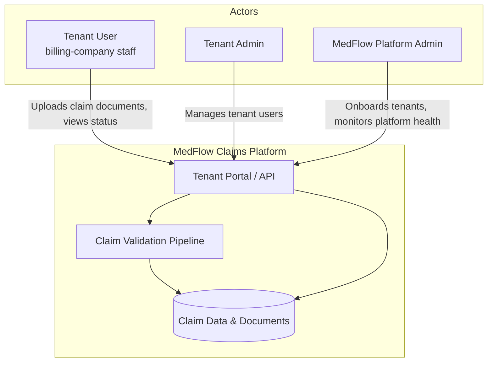

### 9.2 High-Level Architecture

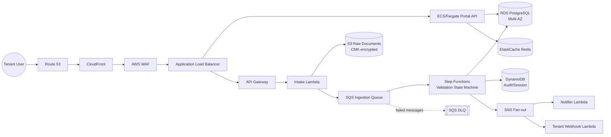

### 9.3 Network Architecture

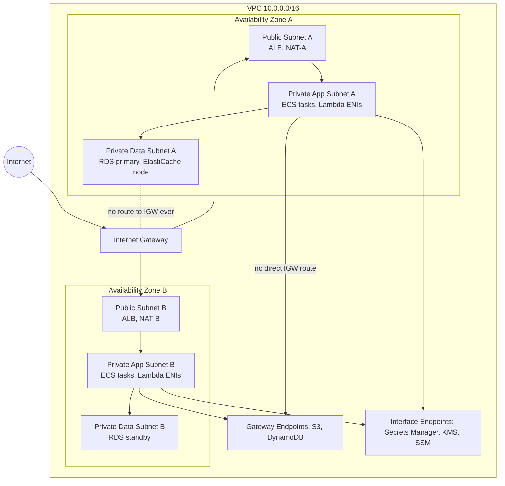

### 9.4 Request Flow (portal read path)

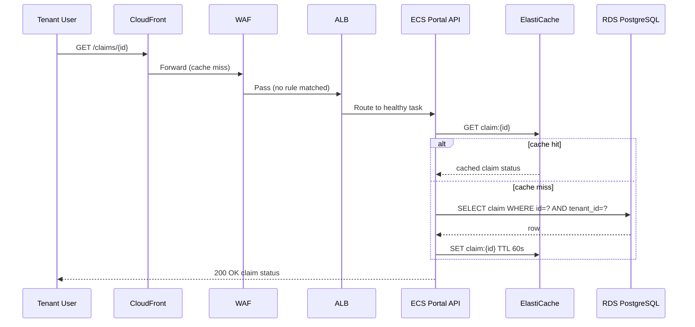

### 9.5 Authentication Flow

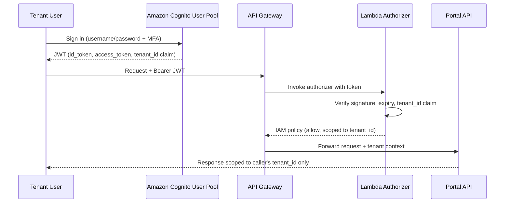

### 9.6 Data Flow (claim document lifecycle)

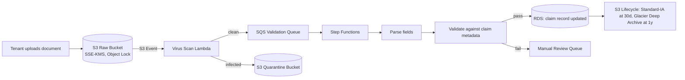

### 9.7 IAM Authorization Flow

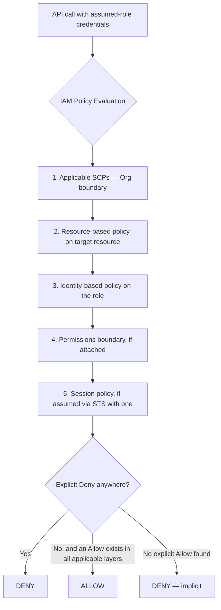

### 9.8 Logging / Monitoring Flow

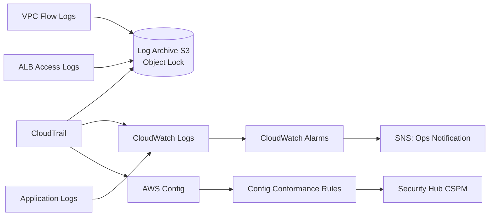

### 9.9 Security Detection Flow

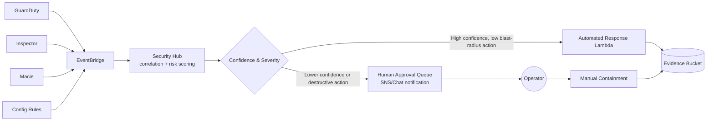

### 9.10 Incident Response Flow

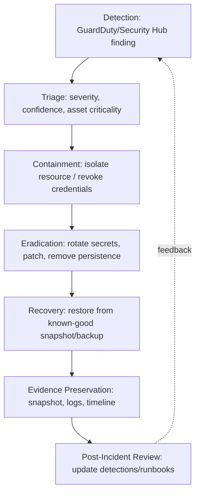

### 9.11 Backup / Recovery Flow

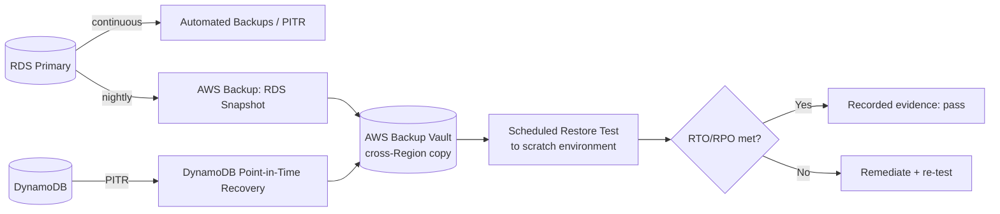

### 9.12 Disaster Recovery Architecture (Pilot Light)

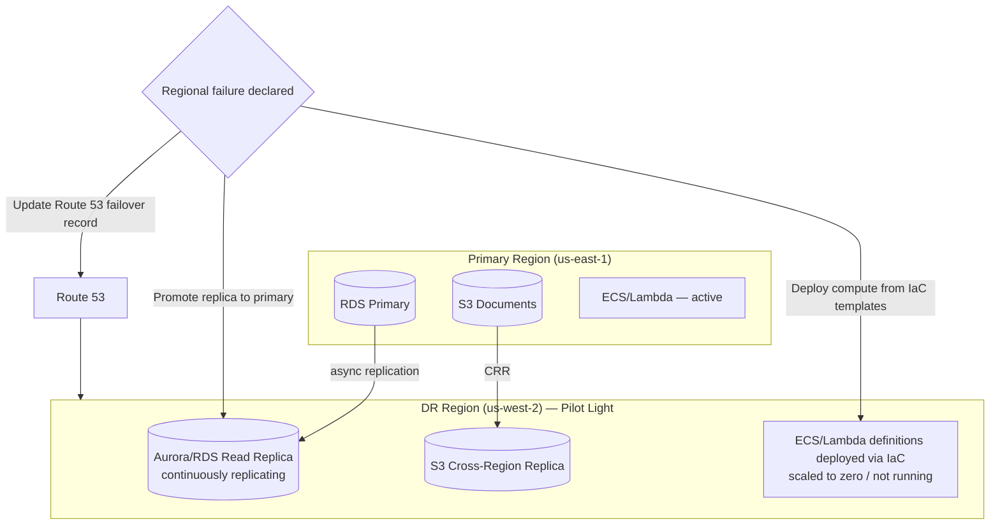

### 9.13 Attacker Path (illustrative, defended in §17)

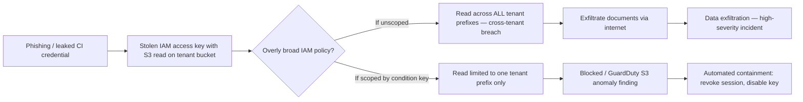

### 9.14 Defensive Control Mapping

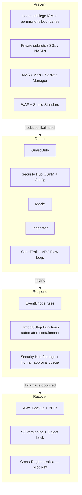

---

## 10. Network Architecture (Detail)

### 10.1 Subnet and Traffic Design

- **North-south traffic** (internet ↔ platform): Internet → Route 53 → CloudFront → WAF → ALB. Only the ALB (and, transiently, NAT Gateways for outbound-only traffic) sit in public subnets. **[DECISION]**
- **East-west traffic** (service ↔ service inside the VPC): App tier → Data tier only, over specific ports (5432 for PostgreSQL, 6379 for Redis) from specific security groups — SGs are referenced by SG-ID, not CIDR, so the rule stays correct even as instances/tasks scale in and out **[AWS FACT — a security group rule can reference another security group as its source, https\://docs.aws.amazon.com/vpc/latest/userguide/security-group-rules.html]**.
- **Egress control**: Learning Lab uses NAT Gateway + VPC endpoints to minimize what egresses to the general internet at all (only OS/package updates and any legitimate third-party API calls). Production-Style adds **AWS Network Firewall** on the egress path with domain-allow-listing, so even a compromised task can only reach an explicitly approved set of external endpoints — a direct control against data exfiltration and C2 callback **[AWS FACT — AWS Network Firewall supports stateful domain-name filtering for outbound traffic, https\://docs.aws.amazon.com/network-firewall/latest/developerguide/stateful-rule-groups-domain-names.html]**.
- **Lateral movement resistance**: data-subnet NACLs deny all inbound except from the app-subnet CIDR on the specific DB/cache ports; SGs are scoped per-tier, not one shared "internal" SG, so a compromised app-tier task cannot reach the data tier on any port the application doesn't actually use.
- **DNS security**: Route 53 Resolver DNS Firewall (Production-Style) blocks resolution of known malicious domains for VPC-resident resources **[AWS FACT — Amazon Route 53 Resolver DNS Firewall filters outbound DNS queries against domain lists, https\://docs.aws.amazon.com/Route53/latest/DeveloperGuide/resolver-dns-firewall.html]**.

### 10.2 Edge and Perimeter

| Control                             | Purpose                                                                                                                                                                          | Learning Lab                              | Production-Style                                                                                                           |
| ----------------------------------- | -------------------------------------------------------------------------------------------------------------------------------------------------------------------------------- | ----------------------------------------- | -------------------------------------------------------------------------------------------------------------------------- |
| Route 53                            | DNS, health-check-based failover                                                                                                                                                 | Public hosted zone                        | + private hosted zone, health checks driving Pilot-Light failover                                                          |
| CloudFront                          | CDN, TLS termination at the edge, reduces origin load, Origin Access Control locks S3 to CloudFront only                                                                         | Yes                                       | Yes, + Lambda\@Edge/CloudFront Functions for header hardening                                                              |
| AWS WAF                             | Layer-7 filtering: managed rule groups (SQLi, XSS, known bad inputs), rate-based rule against the API path                                                                       | Yes, on the ALB and/or CloudFront         | Yes, plus custom rules per tenant path                                                                                     |
| AWS Shield Standard                 | Automatic, no-cost DDoS protection for CloudFront/Route 53/ALB **[AWS FACT — Shield Standard is automatically included at no additional cost, https\://aws.amazon.com/shield/]** | Yes (automatic)                           | Yes (automatic); Shield Advanced evaluated in §14 comparison and excluded on cost grounds for this workload's risk profile |
| VPC Endpoints (Gateway + Interface) | Keep S3/DynamoDB/Secrets Manager/KMS/SSM traffic off the public internet                                                                                                         | Yes                                       | Yes                                                                                                                        |
| PrivateLink                         | Would matter if a third-party SaaS vendor exposed an endpoint service, or if MedFlow exposed its API as a service to a partner's VPC                                             | Not used — no such requirement exists yet | Documented as future option; **excluded now** because no current requirement drives it                                     |
| Transit Gateway                     | Needed once >1 VPC needs shared connectivity (e.g., a separate sandbox VPC talking to shared services)                                                                           | Not used (single VPC)                     | Used to connect Production VPC, Security Tooling VPC, and Sandbox VPC without a full mesh of VPC peering connections       |

### 10.3 Exfiltration and Egress Control Reasoning

**[INFERENCE]** Because Tier-2 data (§5.5) is the highest-value target, the most important network control is not the perimeter facing the internet but the **egress path from the app/data tiers**. A compromised application credential with S3 read access is a realistic breach mode (modeled in §17, scenario 2); the network control that actually limits damage in that scenario is not a WAF rule (WAF inspects *inbound* HTTP) but IAM scoping plus, in the Production-Style build, Network Firewall domain allow-listing that prevents a compromised task from establishing an outbound connection to an attacker-controlled exfiltration endpoint in the first place.

---

## 11. Identity Architecture — IAM Policy Evaluation and RBAC Design

### 11.1 IAM Policy Evaluation Logic

**[AWS FACT]** AWS evaluates all applicable policies together, in this order, and a request is allowed only if there is no explicit Deny anywhere **and** at least one applicable Allow: (1) any Service Control Policies covering the account, (2) any resource-based policy on the target resource, (3) any identity-based policy attached to the principal (user/role, directly or via group), (4) any permissions boundary attached to the principal, and (5) any session policy passed when the credentials were obtained via AWS STS. An explicit `Deny` at *any* layer wins over any `Allow` at any other layer; the absence of any applicable `Allow` results in an implicit deny **[AWS FACT — IAM JSON policy evaluation logic, https\://docs.aws.amazon.com/IAM/latest/UserGuide/reference_policies_evaluation-logic.html]**.

This matters concretely for MedFlow's tenant isolation: an SCP at the Organizations level can enforce "no principal in the Production OU may ever call `s3:GetObject` without an `s3:ExistingObjectTag/tenant_id` condition matching the caller's session tag" — and no identity-based policy inside that account, however permissive, can override that Deny. **[DECISION]** This SCP-level backstop is the Production-Style version's actual tenant-isolation enforcement mechanism, not just documentation.

### 11.2 Role-Based Access Control Model

| Role family             | Who assumes it                                                                   | Key scoping mechanism                                                                                                                                                                      | Example condition                                                                                              |
| ----------------------- | -------------------------------------------------------------------------------- | ------------------------------------------------------------------------------------------------------------------------------------------------------------------------------------------ | -------------------------------------------------------------------------------------------------------------- |
| `TenantAppRuntimeRole`  | ECS tasks / Lambda functions serving portal & pipeline requests                  | Session tag `tenant_id` set at token-vending time by a Cognito-integrated STS `AssumeRoleWithWebIdentity`/custom broker call, referenced in resource policy conditions                     | `"Condition": {"StringEquals": {"s3:ExistingObjectTag/tenant_id": "${aws:PrincipalTag/tenant_id}"}}`           |
| `PlatformAdminRole`     | MedFlow staff, via IAM Identity Center                                           | Permissions boundary capping maximum possible grant even if the role's own policy is broadened later; MFA required in the trust policy condition                                           | `"Condition": {"Bool": {"aws:MultiFactorAuthPresent": "true"}}`                                                |
| `CI/CDDeployRole`       | Pipeline (GitHub Actions OIDC federated identity — no long-lived AWS keys in CI) | Scoped to specific CloudFormation stack ARNs and specific target resource types; cannot touch the RDS instance's data plane, only its infrastructure definition                            | Trust policy restricted to the specific GitHub repo + branch via OIDC subject claim                            |
| `SecurityResponderRole` | The EventBridge-triggered automated-response Lambda (§19)                        | Explicitly scoped to only the reversible actions listed in §19's automation table (revoke a session, isolate a security group) — cannot terminate, delete, or modify IAM policies          | No `iam:*`, no `*:Delete*`, no `*:Terminate*` actions granted at all                                           |
| `BreakGlassRole`        | A human, in a genuine emergency only                                             | Requires a separate approval step (a second person or a documented ticket in the single-operator lab context) and generates a dedicated high-severity CloudTrail-driven alert on every use | Alerting rule fires on `AssumeRole` event for this specific role ARN, always, regardless of confidence scoring |

### 11.3 Cross-Account Access (Production-Style)

Cross-account roles (e.g., Security Tooling account reading GuardDuty/Security Hub findings from Production) use `sts:ExternalId` and are scoped to read-only actions; no cross-account role in this design has write access to Production data — only to Production *security service findings*, which is a materially smaller blast radius **[AWS FACT — the `sts:ExternalId` condition key mitigates the confused-deputy problem in cross-account role assumption, https\://docs.aws.amazon.com/IAM/latest/UserGuide/id_roles_create_for-user_externalid.html]**.

### 11.4 Federation

IAM Identity Center (the current name for the service the SAA-C03 exam guide still labels "AWS Single Sign-On [AWS SSO]" **[AWS FACT — exam guide task statement wording predates the 2022 product rename; current product name and documentation live at https\://docs.aws.amazon.com/singlesignon/latest/userguide/what-is.html]**) is used for **human** access (MedFlow staff), federated from a directory (or, in the Learning Lab, IAM Identity Center's own built-in identity store to avoid standing up a separate directory service). **Tenant end users** are federated separately through **Amazon Cognito User Pools**, because they are external, third-party customers, not internal staff — a distinct identity population with a distinct trust level, which is exactly the kind of decision the exam tests (Domain 1, Task 2: "Security services with appropriate use cases (for example, Amazon Cognito...)").

---

## 12. Data-Security Architecture

### 12.1 Encryption at Rest

| Data store                        | Encryption mechanism                      | Key type                                                               | Rotation                                                                                                                                                                                                                                                                                                                                                                              |
| --------------------------------- | ----------------------------------------- | ---------------------------------------------------------------------- | ------------------------------------------------------------------------------------------------------------------------------------------------------------------------------------------------------------------------------------------------------------------------------------------------------------------------------------------------------------------------------------- |
| S3 raw/processed document buckets | SSE-KMS                                   | Customer-managed key (CMK), one per data tier, aliased per environment | Automatic annual rotation enabled on the CMK **[AWS FACT — AWS KMS supports automatic annual rotation of the key material for customer-managed symmetric keys, https\://docs.aws.amazon.com/kms/latest/developerguide/rotate-keys.html]**                                                                                                                                             |
| RDS PostgreSQL                    | Storage-level encryption at creation time | CMK                                                                    | Same annual rotation; note that changing a CMK on an existing RDS instance requires a new encrypted snapshot/restore, not an in-place change **[AWS FACT — you cannot change the KMS key used to encrypt an existing RDS DB instance in place; you must restore a snapshot with a different key, https\://docs.aws.amazon.com/AmazonRDS/latest/UserGuide/Overview\.Encryption.html]** |
| DynamoDB                          | Encryption at rest, always on             | AWS-owned by default; CMK optional                                     | N/A / CMK rotation if selected                                                                                                                                                                                                                                                                                                                                                        |
| Secrets Manager                   | Encrypted with a CMK                      | CMK                                                                    | Secret *value* rotation independent of the KMS key rotation, on a defined schedule per secret                                                                                                                                                                                                                                                                                         |
| EBS volumes                       | Volume-level encryption                   | CMK                                                                    | Same annual rotation                                                                                                                                                                                                                                                                                                                                                                  |

### 12.2 CMK vs AWS-Managed Key vs Application-Level Encryption

**[RECOMMENDATION]**

- **AWS-managed keys** (e.g., `aws/s3`) are the right choice when there is no requirement to control who specifically can decrypt, and no requirement for a custom key policy, cross-account key sharing, or manual key deletion control. They cost nothing extra and require zero key-policy authoring.
- **Customer-managed KMS keys (CMKs)** are required here because tenant-isolation and audit requirements (§5.6, §5.13) demand a key policy that names specific roles and denies everyone else, and because CloudTrail records every `Decrypt`/`GenerateDataKey` call against a CMK with the calling principal — this is the audit trail an AWS-managed key does not give the same level of control over.
- **Application-level (envelope) encryption** — encrypting a field with a data key obtained via KMS `GenerateDataKey`, before it ever reaches S3/RDS — is used specifically for Tier-2 fields (patient name/DOB) so that even someone with `s3:GetObject` and the bucket's CMK decrypt permission still cannot read those specific fields without an *additional*, narrower field-level key grant. This is the practical difference between "encrypted storage" and "need-to-know field access," and it is the single most defensible tenant-isolation control in the whole design.

### 12.3 Encryption in Transit

TLS 1.2+ enforced at the ALB/CloudFront listener (older TLS versions rejected via listener policy); RDS connections require `sslmode=verify-full` from the application; internal service-to-service calls inside the VPC also use TLS (the VPC boundary is a defense-in-depth layer, not a substitute for transport encryption) **[RECOMMENDATION]**.

### 12.4 Backup Encryption, Data Classification, Retention, Deletion

- AWS Backup vaults use a CMK, and cross-Region backup copies are re-encrypted with a CMK in the destination Region (a KMS key cannot itself be copied across Regions — this is a **[AWS FACT]**: KMS keys are Region-specific, so cross-Region backup/replication requires a separate key in the destination Region **[AWS FACT — https\://docs.aws.amazon.com/kms/latest/developerguide/multi-region-keys-overview\.html]**, and MedFlow uses AWS KMS multi-Region keys for exactly this reason so key material relationships are explicit rather than two unrelated keys).
- **Proposed design:** Tier-2 data deletion would combine object deletion with tenant-specific key destruction. Implementation and end-to-end deletion verification are not established by this design document; ADR-09 records the rationale, not proof of deployment.
- S3 Object Lock (compliance mode) on the raw-document bucket prevents deletion or overwrite of a claim document before its retention date, including by the account root user, which is the specific control that defends against the "malicious insider" and "destructive operator action" scenarios in §17/§20 **[AWS FACT — S3 Object Lock compliance mode prevents object version deletion or overwrite by any user, including the root user, for the specified retention period, https\://docs.aws.amazon.com/AmazonS3/latest/userguide/object-lock-overview\.html]**.

---

## 13. Application Security

**Status boundary:** This table describes the proposed target architecture. It is not evidence that the controls below have been deployed or validated. The current local API uses a client-controlled demo-tenant header; it does not implement Cognito/JWT authentication, a Lambda authorizer, database row-level security, or production API throttling.

| Concern | Proposed target control | Implementation / evidence status |
| --- | --- | --- |
| Authentication | Cognito for tenant users; IAM Identity Center for staff; MFA according to access policy | Proposed; not established as implemented by current project evidence |
| Authorization | Validate JWT tenant claims in an authorizer and enforce tenant isolation at the data-access layer | Proposed; current demo tenant selector is not authentication or authorization |
| Input validation | API schema validation plus application-level validation before processing | Partial local mock validation; production API Gateway / Step Functions path not established |
| Rate limiting | Per-tenant usage controls and WAF rate-based rules | Proposed; production throttling not established |
| SSRF | Avoid arbitrary server-side URL fetching; validate unavoidable webhook destinations and require IMDSv2 where EC2 is used | Design guidance; attack-scenario execution not established |
| Injection | Parameterized database queries and validated workflow inputs | Target requirement; production database/workflow implementation not established |
| Broken access control / IDOR | Enforce tenant isolation in every access path; consider database row-level security as defense in depth | Local mock has tenant-scoped behavior tests; this does not establish production identity or database enforcement |
| Credential theft | Use short-lived role credentials and a managed secret store for required secrets | Target requirement; full production control implementation not established |
| Bot traffic / account takeover | Evaluate Cognito advanced security features and WAF managed protections | Proposed; deployment and tuning not established |
| API abuse | Apply request limits and monitor abnormal request patterns | Proposed; production controls not established |

## 14. Distractor Analysis (Selected)

| Exam concept                 | Real MedFlow implementation                                                                                                             | Why AWS designed it this way                                                                                                                                                      | Trade-off                                                                                                                      | Common plausible-but-wrong distractor                                     | Failure mode of the distractor                                                                                                                                                                         |
| ---------------------------- | --------------------------------------------------------------------------------------------------------------------------------------- | --------------------------------------------------------------------------------------------------------------------------------------------------------------------------------- | ------------------------------------------------------------------------------------------------------------------------------ | ------------------------------------------------------------------------- | ------------------------------------------------------------------------------------------------------------------------------------------------------------------------------------------------------ |
| ALB vs NLB vs GWLB           | ALB in front of the portal API                                                                                                          | ALB understands HTTP semantics (path routing, host-based routing, native WAF integration)                                                                                         | Slightly higher per-request latency than NLB                                                                                   | "Use an NLB for the web tier because it's faster"                         | NLB has no native L7 routing or WAF attachment — you'd have to rebuild that logic yourself                                                                                                             |
| RDS vs DynamoDB              | RDS PostgreSQL for claim metadata; DynamoDB for session/audit events                                                                    | Claims data has relational structure (claims ↔ line items ↔ tenants) and needs ad hoc query flexibility; sessions/audit events are pure key-value, high-volume, latency-sensitive | RDS requires more capacity planning and Multi-AZ cost; DynamoDB requires access-pattern-first design                           | "Use DynamoDB everywhere because it 'scales better'"                      | Modeling relational claim data in DynamoDB without knowing every future access pattern up front leads to expensive redesigns or inefficient scans                                                      |
| NAT Gateway vs NAT instance  | Managed NAT Gateway, one per AZ                                                                                                         | Managed, no patching, higher throughput ceiling                                                                                                                                   | Per-GB data processing charge that a NAT instance (EC2, self-managed) doesn't have                                             | "Use a NAT instance to save money"                                        | NAT instance requires OS patching, doesn't auto-scale in throughput, and is itself a single point of failure unless HA-scripted — the "savings" quickly ties up more operator time than the cost delta |
| SQS vs EventBridge           | SQS for the ingestion buffer (point-to-point work queue with a DLQ); EventBridge for the fan-out/business-event bus and scheduled tasks | SQS is a queue (competing consumers, one message processed once); EventBridge is a bus (many independent rules can match one event)                                               | EventBridge doesn't provide a native DLQ-per-consumer as simply as SQS's queue-level DLQ                                       | "Use EventBridge for the ingestion work queue"                            | EventBridge is not designed for guaranteed ordered work-item processing with visibility timeouts the way SQS is; you'd be fighting the tool                                                            |
| ECS/Fargate vs EC2 vs Lambda | Fargate for the always-on portal API; Lambda for bursty, short-duration event processing                                                | Fargate removes host patching for a long-running service; Lambda's per-invocation billing fits spiky, short workloads                                                             | Fargate costs more per vCPU-hour than an equivalently-sized EC2 Reserved Instance at steady, predictable load                  | "Use Lambda for everything because it's serverless"                       | Lambda's 15-minute max execution time and cold-start behavior make it a poor fit for a persistent, low-latency, high-QPS API service                                                                   |
| CMK vs AWS-managed key       | CMK for Tier-1/2 data                                                                                                                   | Custom key policy + CloudTrail visibility into who decrypted what                                                                                                                 | Slightly more operational overhead (key policy authoring, rotation monitoring) and a small additional per-key-per-month charge | "AWS-managed keys are always sufficient since data is 'encrypted anyway'" | AWS-managed keys can't express the specific tenant-isolation and audit requirement this project's threat model demands                                                                                 |

---

## 15. Offensive Security Perspective

**Security boundary, restated: every scenario below is executed only against resources inside the project owner's own AWS account/Sandbox account, using only tools and techniques against systems the learner owns. No instructions here target third-party systems.**

| #  | Attack                                        | Preconditions                                                                                                                                                                                                                                                                                                  | Technique (safe, self-targeted)                                                                                                                                                                                                                                                        | Expected telemetry                                                                                                                                                                   | Detection                                                                                                                                          | Containment                                                                                                                                                                                          | Recovery                                                                              | Evidence                                                                                                |
| -- | --------------------------------------------- | -------------------------------------------------------------------------------------------------------------------------------------------------------------------------------------------------------------------------------------------------------------------------------------------------------------- | -------------------------------------------------------------------------------------------------------------------------------------------------------------------------------------------------------------------------------------------------------------------------------------- | ------------------------------------------------------------------------------------------------------------------------------------------------------------------------------------ | -------------------------------------------------------------------------------------------------------------------------------------------------- | ---------------------------------------------------------------------------------------------------------------------------------------------------------------------------------------------------- | ------------------------------------------------------------------------------------- | ------------------------------------------------------------------------------------------------------- |
| 1  | Exposed management endpoint                   | A learner temporarily opens SSH/RDP to `0.0.0.0/0` while debugging (a realistic, common mistake)                                                                                                                                                                                                               | Self-scan the lab account's own security groups for `0.0.0.0/0` on port 22/3389 using AWS Config                                                                                                                                                                                       | Config rule non-compliance event; if left open long enough, GuardDuty `UnauthorizedAccess` or `Recon` findings against the instance                                                  | AWS Config managed rule `restricted-ssh`; GuardDuty                                                                                                | Automated: EventBridge → Lambda reverts the SG rule to the last-known-good baseline                                                                                                                  | Redeploy correct SG via IaC; verify with Config                                       | Config compliance timeline, CloudTrail `AuthorizeSecurityGroupIngress` event showing who/when           |
| 2  | Compromised application credential            | A test IAM access key is deliberately generated for the exercise, then used in a way that mimics leaked-credential misuse (e.g., from an unexpected, tagged "test-attacker" source)                                                                                                                            | Use the test key to call `s3:ListBucket`/`GetObject` against the tenant document bucket from outside the normal application context                                                                                                                                                    | GuardDuty `UnauthorizedAccess:IAMUser/InstanceCredentialExfiltration` or `Recon:IAMUser/*` finding; CloudTrail shows the key used from an unusual source                             | GuardDuty; CloudTrail Insights on API call volume                                                                                                  | Automated: revoke the specific STS session / deactivate the access key via the `SecurityResponderRole` (§11.2)                                                                                       | Rotate credential via Secrets Manager, redeploy                                       | GuardDuty finding JSON, CloudTrail event, timeline of key creation → use → revocation                   |
| 3  | SSRF against instance metadata                | Application code intentionally includes a test-only, feature-flagged endpoint that fetches a user-supplied URL (isolated to the Sandbox account only)                                                                                                                                                          | Attempt to make the app fetch `http://169.254.169.254/latest/meta-data/iam/security-credentials/`                                                                                                                                                                                      | With IMDSv2 enforced, the request fails without a valid session token — the point of the exercise is confirming this control works                                                   | Application error log; if IMDSv1 were allowed, GuardDuty would likely fire `UnauthorizedAccess:EC2/MetadataDNSRebind`-class findings               | IMDSv2-only enforced at the instance/launch-template level (`HttpTokens: required`) **[AWS FACT — https\://docs.aws.amazon.com/AWSEC2/latest/UserGuide/configuring-instance-metadata-service.html]** | N/A if control holds; if it fails, isolate instance and rotate the role's credentials | Instance metadata option configuration screenshot + failed-request log as the "control worked" evidence |
| 4  | Stolen temporary credentials (session hijack) | A test STS session token is deliberately copied out of its normal execution context                                                                                                                                                                                                                            | Attempt to reuse the token from a different IP/source after the fact                                                                                                                                                                                                                   | CloudTrail shows the same `accessKeyId` (temporary) used from two different source IPs in a short window                                                                             | GuardDuty `UnauthorizedAccess:IAMUser/InstanceCredentialExfiltration`; a custom detection correlating source-IP changes for the same session       | Session tokens are short-lived by design; automated revocation of the role's active sessions via a session policy update / explicit deny                                                             | Reissue credentials                                                                   | CloudTrail `sourceIPAddress` diff for the same access key                                               |
| 5  | Overly permissive IAM role                    | Deliberately deploy a test role with `s3:*` on `Resource: *` in the Sandbox account                                                                                                                                                                                                                            | Run IAM Access Analyzer / a policy-simulator check against it                                                                                                                                                                                                                          | Access Analyzer finding: "external access" or "unused access" if applicable; Security Hub CSPM control failure (e.g., IAM.1-class overly permissive policy checks)                   | AWS IAM Access Analyzer; Security Hub CSPM                                                                                                         | Automated: flag for remediation, do not auto-delete a role (destructive; needs human approval per §19)                                                                                               | Replace with least-privilege policy, re-scan                                          | Access Analyzer finding, before/after policy diff                                                       |
| 6  | Exposed S3 object                             | Deliberately create a test bucket with public-read ACL in the Sandbox account (never with real tenant data)                                                                                                                                                                                                    | S3 Block Public Access disabled at the bucket level for the test only                                                                                                                                                                                                                  | GuardDuty S3 Protection finding `Policy:S3/BucketPublicAccessGranted`; Config rule `s3-bucket-public-read-prohibited` non-compliant                                                  | GuardDuty S3 Protection; Config; Macie (if sensitive-data patterns are present)                                                                    | Automated: re-enable S3 Block Public Access at bucket/account level                                                                                                                                  | Restore correct bucket policy via IaC                                                 | Config timeline, GuardDuty finding                                                                      |
| 7  | Compromised EC2 instance                      | Deliberately run a benign test process in the Sandbox account that mimics suspicious behavior signatures GuardDuty documents (e.g., communicating with a GuardDuty threat-intel test domain, if AWS provides one, or generating a documented sample finding via GuardDuty's built-in sample-finding generator) | Use GuardDuty's official "Generate sample findings" feature to safely exercise the pipeline without real malicious activity **[AWS FACT — GuardDuty supports generating sample findings for testing purposes, https\://docs.aws.amazon.com/guardduty/latest/ug/sample_findings.html]** | GuardDuty finding of the selected sample type                                                                                                                                        | GuardDuty                                                                                                                                          | Automated: isolate instance (replace SG with a "quarantine" SG with no rules)                                                                                                                        | Forensic snapshot, then terminate and redeploy from known-good AMI/launch template    | Quarantine SG change event, EBS snapshot ID                                                             |
| 8  | Compromised workload identity (container)     | Sandbox ECS task deliberately given an over-broad task role for the exercise                                                                                                                                                                                                                                   | Attempt cross-service calls the task should not need                                                                                                                                                                                                                                   | CloudTrail shows the task role used outside its expected API set                                                                                                                     | Custom CloudTrail-based detection (anomalous API for a given role)                                                                                 | Automated: attach an explicit-deny session policy / disable the task definition                                                                                                                      | Redeploy task with scoped role                                                        | CloudTrail event list for the task role                                                                 |
| 9  | Malicious insider                             | Simulated: a "platform admin" test identity queries tenant data outside a documented support ticket                                                                                                                                                                                                            | Attempt a broad cross-tenant query using the `PlatformAdminRole`                                                                                                                                                                                                                       | CloudTrail data event; a custom detection correlating admin access to tenant data with an open/absent support-ticket reference (application-level control, not a native AWS finding) | Application-level audit log + CloudTrail correlation (Detective)                                                                                   | Human-approved: this is identity-level, so automated technical containment is limited — deactivate the identity, require review                                                                      | HR/process-level, not purely technical                                                | CloudTrail + application audit log correlation, Detective behavior graph                                |
| 10 | Privilege escalation                          | Deliberately test a known IAM privilege-escalation pattern (e.g., a role with `iam:PassRole` + broad `lambda:CreateFunction` permissions, a documented escalation vector) against a throwaway role in Sandbox                                                                                                  | Attempt to create a Lambda function that assumes a higher-privileged role via `PassRole`                                                                                                                                                                                               | CloudTrail shows `CreateFunction` + `PassRole` pairing from a role that shouldn't need it                                                                                            | IAM Access Analyzer policy validation; Security Hub CSPM (IAM controls); a custom EventBridge rule matching `iam:PassRole` calls from non-CI roles | Automated: deny further `PassRole` from that identity via an explicit-deny policy patch                                                                                                              | Remove the escalation-enabling permission pairing from the role                       | CloudTrail event correlation                                                                            |
| 11 | Lateral movement                              | From a deliberately-compromised sandbox app-tier task, attempt to reach the data-tier SG on a port it shouldn't have                                                                                                                                                                                           | Attempt connection; expect it to be blocked by SG/NACL                                                                                                                                                                                                                                 | VPC Flow Log `REJECT` record                                                                                                                                                         | VPC Flow Logs + GuardDuty (network-based findings)                                                                                                 | N/A if blocked (control validated); if it succeeds, immediately treat as a network segmentation failure and re-architect                                                                             | Fix SG/NACL rule, re-test                                                             | VPC Flow Log record showing REJECT                                                                      |
| 12 | Data exfiltration                             | From the same sandbox context, attempt an outbound connection to a non-allow-listed external endpoint                                                                                                                                                                                                          | Attempt outbound HTTPS to an arbitrary test domain                                                                                                                                                                                                                                     | With Network Firewall domain allow-listing (Production-Style), the connection is blocked; without it (Learning Lab), VPC Flow Logs record the flow and GuardDuty may flag it         | Network Firewall logs / VPC Flow Logs / GuardDuty                                                                                                  | Automated (Production-Style): Network Firewall blocks by policy; Learning Lab: detect via Flow Logs, respond manually                                                                                | Add explicit egress control if missing                                                | Flow log record, Network Firewall alert log                                                             |
| 13 | DNS abuse                                     | Attempt DNS resolution of a known-bad-category test domain from within the VPC                                                                                                                                                                                                                                 | Query via Route 53 Resolver                                                                                                                                                                                                                                                            | With DNS Firewall (Production-Style), the query is blocked                                                                                                                           | Route 53 Resolver DNS Firewall query logs                                                                                                          | Automated block by policy                                                                                                                                                                            | N/A                                                                                   | DNS Firewall log entry                                                                                  |
| 14 | API abuse                                     | Send request volume from a single test API key exceeding the configured usage plan                                                                                                                                                                                                                             | Burst requests against the API Gateway usage-plan-limited key                                                                                                                                                                                                                          | API Gateway throttling response (429)                                                                                                                                                | API Gateway execution logs, CloudWatch metrics                                                                                                     | Automatic (built-in throttling, no custom Lambda needed)                                                                                                                                             | N/A                                                                                   | CloudWatch `ThrottleCount` metric                                                                       |
| 15 | Credential leakage (e.g., accidental commit)  | Deliberately commit a fake, clearly-labeled canary credential to a private test repo                                                                                                                                                                                                                           | Monitor whether any automated scanning/GuardDuty Malware Protection-style tooling or a git pre-commit secret scanner catches it before merge                                                                                                                                           | Pre-commit hook rejection (preventive) or, if missed, use of the canary key triggers GuardDuty                                                                                       | Pre-commit secret scanner (e.g., a hook checking for AWS key patterns) + GuardDuty as a backstop                                                   | Automated: canary key is scoped to zero real permissions, so "containment" is definitionally already in place by design                                                                              | Rotate any adjacent real secrets as a precaution                                      | Git hook log / GuardDuty finding on canary key use                                                      |
| 16 | Supply-chain compromise                       | Review (not exploit) — dependency-confusion and malicious-package risk is addressed via Amazon Inspector's software composition analysis on the ECR image and Lambda layers                                                                                                                                    | N/A (detective control, not an active exercise against a live package)                                                                                                                                                                                                                 | Inspector finding for a vulnerable/known-bad package version                                                                                                                         | Amazon Inspector                                                                                                                                   | Patch/replace the dependency; block the image from deployment via ECR image scanning gate                                                                                                            | Redeploy patched image                                                                | Inspector finding report                                                                                |
| 17 | Denial-of-service conditions                  | Controlled load test (§22) intentionally exceeding provisioned capacity in the Sandbox account, **not** a real DDoS technique against any live endpoint                                                                                                                                                        | Use a load-testing tool against the Sandbox environment's own endpoint, within AWS's load-testing policy for self-owned resources                                                                                                                                                      | ALB 5xx rate increase, Auto Scaling activity, CloudWatch alarms                                                                                                                      | CloudWatch alarms on latency/error-rate                                                                                                            | Auto Scaling absorbs organic load; WAF rate-based rule + Shield Standard absorb network/transport-layer floods automatically                                                                         | Scale-in after load test ends                                                         | Load-test report + CloudWatch metrics during the window                                                 |

### 15.1 STRIDE Threat Model (Selected High-Value Assets)

| Threat                 | Asset                   | Entry point                                      | Attack path                                                      | Existing control                                                   | Detection                                                                                                                      | Residual risk                                                                                                  | Mitigation                                                                                                                   |
| ---------------------- | ----------------------- | ------------------------------------------------ | ---------------------------------------------------------------- | ------------------------------------------------------------------ | ------------------------------------------------------------------------------------------------------------------------------ | -------------------------------------------------------------------------------------------------------------- | ---------------------------------------------------------------------------------------------------------------------------- |
| Spoofing               | Tenant identity         | Cognito login                                    | Credential stuffing against a tenant user                        | Cognito adaptive MFA, compromised-credential check                 | Cognito advanced security events, CloudWatch                                                                                   | Medium — MFA fatigue/social engineering against a user is not an infrastructure control                        | Enforce MFA for all roles capable of viewing Tier-2 data; monitor login anomalies                                            |
| Tampering              | Claim document          | S3 upload path                                   | Uploading a modified document after initial validation           | S3 Object Lock + versioning; SHA-256 checksum recorded at ingest   | S3 Object Lock denial event if attempted; checksum mismatch alarm                                                              | Low, given Object Lock compliance mode                                                                         | Maintain immutability window ≥ full processing lifecycle                                                                     |
| Repudiation            | Claim status change     | Application write path                           | A tenant admin disputes having approved a claim change           | CloudTrail data events + application audit log with actor identity | Query CloudTrail/audit log on dispute                                                                                          | Low                                                                                                            | Ensure every write carries the authenticated principal, not a service-account identity                                       |
| Information disclosure | Cross-tenant data       | Application query layer bug                      | A bug omits the `tenant_id` filter                               | Row-level security backstop (§13); IAM condition keys on S3        | Application error/anomaly monitoring; a synthetic canary test that queries as Tenant A and asserts it never sees Tenant B rows | Medium — application logic bugs are the hardest class to eliminate entirely                                    | Automated cross-tenant canary test in CI (§29)                                                                               |
| Denial of service      | API/portal availability | Public API endpoint                              | Volumetric or application-layer flood                            | WAF rate-based rules, Shield Standard, Auto Scaling                | CloudWatch alarms                                                                                                              | Low for volumetric (Shield Standard/CloudFront absorb most); Medium for sophisticated application-layer floods | Consider Shield Advanced only if a specific past incident or elevated risk profile justifies the added cost (§14 comparison) |
| Elevation of privilege | IAM role escalation     | `iam:PassRole` + `lambda:CreateFunction` pairing | Attacker with limited role escalates via a Lambda execution role | IAM Access Analyzer, scoped permissions                            | Custom CloudTrail correlation rule                                                                                             | Medium until the specific escalation pairing is actively hunted for                                            | Add explicit-deny guardrail SCP against risky permission pairings account-wide                                               |

---

## 16. Defensive Detection Model

### 16.1 Prevent / Detect / Respond / Recover Control Inventory

| Layer   | Controls used                                                                                                                                                                                                                                              | Notes                                                                     |
| ------- | ---------------------------------------------------------------------------------------------------------------------------------------------------------------------------------------------------------------------------------------------------------- | ------------------------------------------------------------------------- |
| Prevent | Least-privilege IAM + permissions boundaries; SCPs; private subnets/SGs/NACLs; KMS + Secrets Manager; WAF; IMDSv2 enforcement; S3 Block Public Access at the account level                                                                                 | Preventive controls reduce likelihood, not to zero                        |
| Detect  | GuardDuty; Security Hub (correlation/risk scoring) + Security Hub CSPM (posture/compliance checks); Inspector (vulnerability/SCA); Macie (sensitive-data discovery in S3); Detective (behavior-graph investigation); VPC Flow Logs; CloudWatch; AWS Config | See §16.2 for the naming clarification                                    |
| Respond | EventBridge rules matching specific finding types; Lambda/Step Functions for reversible automated containment; Security Hub findings routed to a human-approval queue for anything destructive                                                             | §19 has the full false-positive/negative and automation-caution reasoning |
| Recover | AWS Backup + PITR; S3 Versioning + Object Lock; cross-Region replica (pilot light); documented, rehearsed recovery runbooks                                                                                                                                | §18/§21                                                                   |

### 16.2 Important Naming Clarification — Security Hub GA (December 2025)

**[AWS FACT, post-cutoff research finding]** In December 2025, AWS announced general availability of a re-architected **Security Hub** that adds near-real-time risk analytics and automatic correlation of signals from GuardDuty, Inspector, and the posture-management checks that used to simply be called "Security Hub" — those posture/compliance checks (CIS/NIST/PCI-style controls, e.g., `S3.1`, `IAM.1`) are now branded **Security Hub CSPM**, and are consumed *by* the new correlation-focused Security Hub rather than being the same product **[Source: AWS News Blog, "AWS Security Hub now generally available with near real-time analytics and risk prioritization," Dec 2, 2025, https\://aws.amazon.com/blogs/aws/aws-security-hub-now-generally-available-with-near-real-time-analytics-and-risk-prioritization/; AWS What's New post, https\://aws.amazon.com/about-aws/whats-new/2025/12/security-hub-near-real-time-risk-analytics/]**. Existing Security Hub CSPM customers had to opt in to the new GA experience by January 15, 2026, or lose their configuration organization-wide **[AWS FACT — AWS Security Hub documentation, "Public Preview to General Availability migration," https\://docs.aws.amazon.com/securityhub/latest/userguide/public-preview-to-ga-migration.html]**. Because this postdates this document's reliable training-data cutoff, it was verified via live search rather than recalled, and is flagged here explicitly per this project's own evidence-integrity rules. This document uses "**Security Hub**" for the correlation/risk-scoring layer and "**Security Hub CSPM**" for the underlying compliance-control checks, matching current AWS terminology as of the research date.

### 16.3 Detection Catalogue

| Detection                                                                              | Data source                                                                                                  | Trigger/condition                                                                            | Severity                              | Expected TP behavior                                                         | Expected FP                                                                                                     | Expected FN                                                                                                        | Tuning mechanism                                                                                                             | Automated response                                                                    | Human approval required?                                                              |
| -------------------------------------------------------------------------------------- | ------------------------------------------------------------------------------------------------------------ | -------------------------------------------------------------------------------------------- | ------------------------------------- | ---------------------------------------------------------------------------- | --------------------------------------------------------------------------------------------------------------- | ------------------------------------------------------------------------------------------------------------------ | ---------------------------------------------------------------------------------------------------------------------------- | ------------------------------------------------------------------------------------- | ------------------------------------------------------------------------------------- |
| Unauthorized IAM credential use from unusual source                                    | GuardDuty (`UnauthorizedAccess:IAMUser/*`)                                                                   | Access key used from a geographically/behaviorally anomalous source relative to its baseline | High                                  | Confirms real key misuse                                                     | Legitimate remote-work travel, VPN egress changes, CI runners in new regions                                    | A slow, low-and-slow credential misuse that stays within the "normal" baseline                                     | Add known corporate VPN/CI egress ranges to a documented allow-list reviewed quarterly                                       | Revoke session / deactivate key                                                       | No, if confidence is high and the account is a workload role (not a human)            |
| S3 bucket made public                                                                  | GuardDuty S3 Protection + Config (`s3-bucket-public-read-prohibited`)                                        | ACL/policy change grants public access                                                       | High                                  | Confirms real exposure                                                       | A legitimate, explicitly-approved public asset bucket (e.g., static marketing site) not yet allow-listed        | A public-access grant made through a mechanism the rule doesn't check (rare given both ACL and policy are covered) | Maintain an explicit exception list for approved public buckets, reviewed on every list change                               | Automatically re-enable Block Public Access                                           | No — this action is reversible and low blast-radius                                   |
| Privilege-escalation permission pairing (`iam:PassRole` + risky compute-create action) | Custom CloudTrail-based EventBridge rule                                                                     | Specific action pairing from a non-CI, non-break-glass role                                  | High                                  | Confirms a genuine escalation attempt or a misconfigured pipeline            | A newly-onboarded, legitimately-scoped automation role not yet added to the CI allow-list                       | An escalation path this rule doesn't enumerate (new AWS service/action combination)                                | Maintain and periodically re-derive the list of known escalation-enabling action pairs                                       | Flag + explicit-deny patch proposal to human queue                                    | **Yes** — modifying IAM policy is not auto-approved                                   |
| Sensitive data discovered outside the expected Tier-2 location                         | Macie                                                                                                        | Macie classification job finds SSN/DOB-pattern data in an unexpected S3 prefix/bucket        | High                                  | A real data-handling mistake (e.g., a debug export left in the wrong bucket) | Macie pattern-matching false-positives on structurally similar but non-sensitive test data                      | Encrypted/compressed sensitive data Macie cannot inspect the contents of                                           | Maintain a suppression list for known synthetic test-data prefixes                                                           | Flag + restrict bucket to break-glass-only until reviewed                             | **Yes**                                                                               |
| Instance/container behavioral anomaly (e.g., unusual outbound port/behavior)           | GuardDuty EC2/ECS runtime findings                                                                           | Statistical/ML-based baseline deviation                                                      | Medium–High depending on finding type | Confirms compromise-consistent behavior                                      | New, legitimate application behavior after a deploy (e.g., a new integration calling a new external API)        | Attacker behavior that closely mimics existing legitimate traffic patterns                                         | Suppress specific finding subtype temporarily after a verified deploy, with an expiry, never a permanent blanket suppression | Isolate via quarantine SG                                                             | No for isolation (reversible); **yes** for terminate/rebuild                          |
| Vulnerable software dependency                                                         | Inspector (SCA on ECR image / Lambda layers)                                                                 | CVE match against installed package versions                                                 | Severity per CVSS                     | Confirms real vulnerable dependency present                                  | A CVE affecting a code path the application doesn't actually exercise (reachability not assessed by CVSS alone) | A vulnerability not yet in the CVE database (zero-day)                                                             | Track exploitability/reachability manually for anything CVSS ≥ 7 before treating as urgent                                   | Block deployment gate for Critical/High findings                                      | No for blocking a deploy (reversible, low-risk default); **yes** to override the gate |
| Config rule non-compliance (e.g., encryption disabled, MFA not enforced on root)       | AWS Config + Security Hub CSPM                                                                               | Resource configuration drifts from the defined conformance pack                              | Medium–High depending on control      | Confirms a real posture drift                                                | A resource intentionally and temporarily out of compliance during a maintenance window                          | A misconfiguration outside the specific conformance pack's rule set                                                | Maintenance-window suppression with an automatic expiry, logged                                                              | Auto-remediate low-risk items only (e.g., re-enable a logging setting); flag the rest | **Yes** for anything touching IAM/network/data resources                              |
| Anomalous cross-tenant query attempt                                                   | Application-level synthetic canary + audit log correlation (not a native AWS "finding" — a custom detection) | Canary test detects Tenant-A-scoped credentials returning any Tenant-B row                   | Critical                              | Confirms a real tenant-isolation defect                                      | Near-zero expected FP rate by design (the canary is deterministic)                                              | A code path the canary doesn't exercise                                                                            | Expand canary coverage as new query paths are added                                                                          | Immediate deploy freeze, page the operator                                            | **Yes**, always — this is the platform's most severe possible finding                 |

### 16.4 Detection-Quality Methodology (False Positive / False Negative Engineering)

This is treated as a formal discipline, not a slogan:

1. **Signal correlation before action.** A single GuardDuty finding of medium severity does not, by itself, trigger anything destructive. Security Hub's correlation layer (§16.2) is used specifically to raise confidence by combining multiple weaker signals (e.g., an unusual IAM call *and* an unusual network flow *and* a Config drift, all touching the same resource within a short window) before escalating severity **[AWS FACT — Security Hub correlates and enriches findings from GuardDuty, Inspector, and Security Hub CSPM, https\://aws.amazon.com/about-aws/whats-new/2025/12/security-hub-near-real-time-risk-analytics/]**.
2. **Baselines and allow-lists**, reviewed on a fixed cadence (quarterly) and on every legitimate infrastructure change, not created ad hoc during an active investigation (which would bias the analyst toward suppressing the very thing under investigation).
3. **Resource, identity, and business-criticality context** are attached to every finding: a medium-severity finding against the Tier-2 document bucket is treated with more urgency than the same severity against a disposable dev-test bucket.
4. **Confidence scoring** determines automation eligibility: only detections with both (a) a low historical false-positive rate for that specific rule and (b) a fully reversible corresponding action are eligible for fully automated response (§19 automation table). Everything else queues for human approval — a direct, explicit application of the single-operator staffing assumption in §5.12.
5. **Suppression requires an expiry and a reason code**, logged to the evidence bucket, never a silent permanent mute — this prevents suppression rules from silently accumulating into blind spots.
6. **Deduplication** happens at the Security Hub correlation layer so the same underlying event doesn't generate five separate response actions.
7. **Escalation thresholds** are defined per detection (e.g., three findings of the same type against the same resource within 15 minutes escalates severity one level).
8. **Why over-automation is dangerous, stated plainly:** an automated system that can delete, terminate, or revoke IAM policy in response to a *false positive* can cause a self-inflicted outage indistinguishable from a real incident — and, worse, can be *triggered by an attacker deliberately generating noisy, low-confidence findings* to bait the automation into taking a destructive action against production (a documented category of attack against automated security response). This is precisely why §11.2's `SecurityResponderRole` has no delete/terminate/IAM-write permissions at all — the automation is architecturally incapable of taking a destructive action even if instructed to, which is a stronger guarantee than "we configured it not to."
9. **Known residual false-negative risk is stated, not hidden**: slow, low-and-slow credential misuse that never crosses a statistical anomaly threshold; sophisticated application-layer logic bugs the synthetic canary doesn't happen to exercise; and zero-day vulnerabilities not yet in any CVE feed are all acknowledged as detection gaps this architecture does **not** claim to close.

---

## 17. Incident Response Architecture

| # | Scenario                                                                | Detection                                                                                                                                      | Triage                                                                                                                                       | Containment                                                                                                                                                               | Eradication                                                                                                                                                                                                                                                                                                                                                                                                                     | Recovery                                                                                                                                                                               | Evidence preservation                                                                             | Post-incident improvement                                                                                                                                                                                                             |
| - | ----------------------------------------------------------------------- | ---------------------------------------------------------------------------------------------------------------------------------------------- | -------------------------------------------------------------------------------------------------------------------------------------------- | ------------------------------------------------------------------------------------------------------------------------------------------------------------------------- | ------------------------------------------------------------------------------------------------------------------------------------------------------------------------------------------------------------------------------------------------------------------------------------------------------------------------------------------------------------------------------------------------------------------------------- | -------------------------------------------------------------------------------------------------------------------------------------------------------------------------------------- | ------------------------------------------------------------------------------------------------- | ------------------------------------------------------------------------------------------------------------------------------------------------------------------------------------------------------------------------------------- |
| 1 | Stolen application credential                                           | GuardDuty `UnauthorizedAccess` finding, CloudTrail unusual-source event                                                                        | Confirm the key belongs to a real workload role; check what it can access                                                                    | Revoke active STS sessions, deactivate the access key via `SecurityResponderRole`                                                                                         | Rotate the underlying secret in Secrets Manager; audit everything the key touched via CloudTrail                                                                                                                                                                                                                                                                                                                                | Redeploy the affected service with the new credential; verify functionality                                                                                                            | Export CloudTrail events for the key's lifetime to the evidence bucket, snapshot the finding JSON | Add the credential's source pattern to the anomaly baseline review; check whether the leak vector (e.g., a log line) is closed                                                                                                        |
| 2 | Compromised EC2/ECS workload                                            | GuardDuty runtime finding                                                                                                                      | Identify blast radius: what IAM role, what network reachability did this workload have                                                       | Isolate via quarantine SG (no ingress/egress except to the forensics VPC)                                                                                                 | Snapshot the EBS volume/container filesystem for analysis before termination; identify persistence mechanism                                                                                                                                                                                                                                                                                                                    | Terminate and redeploy from a known-good AMI/image; rotate any credentials the workload held                                                                                           | EBS snapshot, process list captured via SSM Run Command before isolation, GuardDuty finding       | Patch the vulnerability class that allowed compromise; add an Inspector rule if it was a known CVE                                                                                                                                    |
| 3 | Accidental public S3 exposure                                           | GuardDuty S3 Protection / Config                                                                                                               | Determine what was exposed and for how long (CloudTrail history)                                                                             | Automated: re-enable Block Public Access                                                                                                                                  | Determine if Tier-2 data was in the exposed prefix; if so, treat as a data-breach-scope event, not just a config error                                                                                                                                                                                                                                                                                                          | Restore correct bucket policy via IaC; if genuine breach scope, follow applicable notification obligations (external legal/compliance process, outside this project's technical scope) | Access logs for the exposure window, before/after policy diff                                     | Add the specific misconfiguration pattern to a pre-deploy IaC policy check (e.g., `cfn-guard`/Config rule that blocks the *plan* from ever applying)                                                                                  |
| 4 | Overly permissive IAM role discovered                                   | IAM Access Analyzer / Security Hub CSPM finding                                                                                                | Determine if the role has been used to exceed its intended scope (CloudTrail history)                                                        | Do not immediately delete the role (destructive); attach an explicit-deny session policy limiting it to observed-legitimate actions only, pending review                  | Rewrite policy to least privilege; test against real usage patterns before finalizing                                                                                                                                                                                                                                                                                                                                           | Deploy corrected policy via IaC; monitor for access-denied errors indicating the fix was too aggressive                                                                                | Access Analyzer report, before/after policy diff                                                  | Add the account-wide guardrail SCP that would have prevented this class of over-grant                                                                                                                                                 |
| 5 | Suspicious data exfiltration                                            | VPC Flow Logs / Network Firewall / GuardDuty                                                                                                   | Identify source resource, destination, volume, and whether it correlates with any legitimate business process (e.g., a scheduled backup job) | Isolate the source resource; block the destination at the Network Firewall/SG level                                                                                       | Identify how the resource obtained the ability to reach that destination; close that path                                                                                                                                                                                                                                                                                                                                       | Restore the resource from known-good state if compromise is confirmed                                                                                                                  | Flow log export for the exfiltration window, destination IP/domain reputation lookup              | Tighten egress allow-list; consider whether DLP-style controls (Macie policies) need expansion                                                                                                                                        |
| 6 | Destructive operator action (accidental deletion)                       | CloudTrail `Delete*`/`Terminate*` event correlated with no active change ticket                                                                | Confirm this was accidental vs. malicious (check the identity and whether it matches an approved change)                                     | N/A (already occurred) — focus shifts immediately to recovery                                                                                                             | N/A                                                                                                                                                                                                                                                                                                                                                                                                                             | Restore from AWS Backup / S3 Versioning / RDS PITR to the point immediately before the deletion                                                                                        | CloudTrail event showing exactly what was deleted, by whom, when                                  | Require MFA-protected deletion or an approval workflow for the specific action class going forward (e.g., `s3:DeleteBucket`, `rds:DeleteDBInstance` restricted by SCP to a break-glass role only)                                     |
| 7 | Ransomware-style data corruption                                        | Anomalous mass-modification pattern in CloudTrail data events / unexpected spike in S3 `PutObject`/`DeleteObject` volume against existing keys | Determine scope: which objects/records were modified, over what time window                                                                  | Isolate the source identity/resource immediately; suspend further writes from it                                                                                          | Identify and close the compromise vector that allowed mass modification                                                                                                                                                                                                                                                                                                                                                         | Restore affected objects from S3 Versioning (previous versions) and affected DB rows from Aurora/RDS PITR to just before the corruption started                                        | Version history diff, PITR restore timestamp justification, corrupted-object list                 | This is the scenario that most directly validates whether Object Lock + Versioning + PITR were actually sufficient — documented as Failure Lab #11's real-world analogue                                                              |
| 8 | Security monitoring failure (GuardDuty/CloudTrail disabled or degraded) | A meta-detection: EventBridge rule specifically watching for `StopLogging`, `DeleteTrail`, or GuardDuty detector disablement API calls         | Treat as maximum severity immediately — an attacker disabling monitoring is a strong signal of active compromise                             | Automated: re-enable the disabled control immediately (this specific action is intentionally on the "safe to automate" list because re-enabling logging is never harmful) | Investigate who disabled it and why, using whatever logging survived (CloudTrail's own log-file integrity validation helps confirm nothing was altered, only that logging *stopped* **[AWS FACT — CloudTrail log file integrity validation uses digitally signed digest files to detect after-the-fact log tampering, https\://docs.aws.amazon.com/awscloudtrail/latest/userguide/cloudtrail-log-file-validation-intro.html]**) | Restore full logging, back-fill any gap analysis using VPC Flow Logs / Config history if CloudTrail has a gap                                                                          | Digest file validation results, gap-window analysis                                               | This is why CloudTrail is configured to be **organization-wide and immutable to the account it's monitoring** in the Production-Style design — the monitored account should not itself have full IAM control over its own audit trail |

---

## 18. Resilience Engineering and Disaster Recovery Design

### 18.1 Controlled Failure Scenarios

| Scenario                                                           | Expected behavior                                                                                                                                                                                               | RTO                                                                                                                                                                                                                                                                                            | RPO                                                                                                                                                                                                                                     | Observed-behavior validation method                                                           | Residual risk                                                                                                                                                                                                                                                                                                                                                           |
| ------------------------------------------------------------------ | --------------------------------------------------------------------------------------------------------------------------------------------------------------------------------------------------------------- | ---------------------------------------------------------------------------------------------------------------------------------------------------------------------------------------------------------------------------------------------------------------------------------------------- | --------------------------------------------------------------------------------------------------------------------------------------------------------------------------------------------------------------------------------------- | --------------------------------------------------------------------------------------------- | ----------------------------------------------------------------------------------------------------------------------------------------------------------------------------------------------------------------------------------------------------------------------------------------------------------------------------------------------------------------------- |
| EC2/ECS task failure                                               | ALB/ECS health check fails, unhealthy target deregistered, Auto Scaling/ECS service scheduler launches a replacement                                                                                            | < 2 minutes                                                                                                                                                                                                                                                                                    | 0 (stateless tier)                                                                                                                                                                                                                      | Failure Lab #1 — kill a task manually, time the recovery                                      | Brief capacity dip if the failure coincides with peak load                                                                                                                                                                                                                                                                                                              |
| Availability Zone impairment                                       | Traffic and RDS failover automatically to the healthy AZ                                                                                                                                                        | < 5 minutes (RDS Multi-AZ typical failover) **[AWS FACT — RDS Multi-AZ failover typically completes within 60–120 seconds, though the practical end-to-end application impact depends on connection handling, https\://docs.aws.amazon.com/AmazonRDS/latest/UserGuide/Concepts.MultiAZ.html]** | 0 (synchronous replication to standby)                                                                                                                                                                                                  | Failure Lab #2 — simulate AZ impairment by stopping all resources in one AZ                   | Applications that don't handle a DB connection reset gracefully will see a burst of errors during the failover window — validated and fixed via connection retry logic                                                                                                                                                                                                  |
| Database failover (forced)                                         | Application reconnects to the promoted standby without a code change (same endpoint, DNS re-pointed by RDS)                                                                                                     | Same as above                                                                                                                                                                                                                                                                                  | 0                                                                                                                                                                                                                                       | Failure Lab #3 — forced failover via RDS console/API                                          | Application must implement retry-with-backoff on connection errors, or the failover window causes visible errors                                                                                                                                                                                                                                                        |
| Application dependency failure (third-party webhook endpoint down) | Circuit breaker stops retrying after N failures, alerts operator, resumes automatically on next successful health probe                                                                                         | N/A (does not affect core platform availability)                                                                                                                                                                                                                                               | N/A                                                                                                                                                                                                                                     | Failure Lab #4                                                                                | The affected tenant's webhook notifications are delayed until their endpoint recovers — an accepted, documented trade-off                                                                                                                                                                                                                                               |
| Queue backlog                                                      | SQS absorbs the burst; Auto Scaling on queue depth adds consumer capacity; DLQ catches poison messages                                                                                                          | Depends on backlog depth and Lambda/consumer concurrency limits                                                                                                                                                                                                                                | 0 (no message loss, SQS retains for up to 14 days) **[AWS FACT — SQS supports a maximum message retention period of 14 days, https\://docs.aws.amazon.com/AWSSimpleQueueService/latest/SQSDeveloperGuide/sqs-basic-architecture.html]** | Failure Lab #5 — inject 10x normal message volume                                             | If backlog outlives the 14-day retention window, messages are lost — this is an explicit, quantified residual risk that drives the alarm threshold                                                                                                                                                                                                                      |
| Cache failure                                                      | Application falls through to RDS on cache miss with a shorter timeout                                                                                                                                           | No outage, elevated latency and DB load                                                                                                                                                                                                                                                        | 0                                                                                                                                                                                                                                       | Failure Lab #6 — stop the ElastiCache node                                                    | Sustained cache outage under peak load could overload RDS — validated via load test in §22                                                                                                                                                                                                                                                                              |
| DNS failure                                                        | Not directly testable against Route 53 itself (a managed service outside the account's control); documented as a residual, un-mitigated risk at the DNS-provider level unless a secondary DNS provider is added | N/A                                                                                                                                                                                                                                                                                            | N/A                                                                                                                                                                                                                                     | Documented, not lab-tested                                                                    | **[ASSUMPTION]** — accepted risk for this project's scale; Route 53's own SLA is the mitigating factor, not an architectural control this project adds                                                                                                                                                                                                                  |
| Bad deployment                                                     | Automatic rollback on failed ECS health checks / Lambda alias traffic shift halted on error-rate alarm                                                                                                          | < 5 minutes to detect and roll back                                                                                                                                                                                                                                                            | 0                                                                                                                                                                                                                                       | Failure Lab #7 — deploy a deliberately broken container image                                 | A slow-failing deploy (passes health checks but is subtly wrong) is a residual risk not caught by health checks alone — mitigated partially by the synthetic canary in §16.3                                                                                                                                                                                            |
| Accidental deletion                                                | Recovered from AWS Backup / S3 Versioning / RDS PITR                                                                                                                                                            | ≤ 2 hours target                                                                                                                                                                                                                                                                               | ≤ 5 minutes (PITR granularity)                                                                                                                                                                                                          | Failure Lab #11 restore test                                                                  | Deletion of the backup vault itself is the remaining single point of failure — mitigated by cross-Region backup copy and vault access policies restricting deletion                                                                                                                                                                                                     |
| Data corruption                                                    | Restored via PITR to just before corruption                                                                                                                                                                     | ≤ 2 hours                                                                                                                                                                                                                                                                                      | ≤ 5 minutes                                                                                                                                                                                                                             | Failure Lab #11 variant                                                                       | Corruption that goes undetected long enough to age out of the PITR window (typically up to 35 days for RDS) is a residual risk **[AWS FACT — Amazon RDS automated backups support point-in-time recovery within the configured backup retention period, up to 35 days, https\://docs.aws.amazon.com/AmazonRDS/latest/UserGuide/USER_WorkingWithAutomatedBackups.html]** |
| Regional failure                                                   | Pilot Light promoted to active                                                                                                                                                                                  | ≤ 4 hours (target, §5.10)                                                                                                                                                                                                                                                                      | ≤ 15 minutes (target, §5.10)                                                                                                                                                                                                            | Documented DR game-day exercise, timed once as a scoped exercise, not run continuously (cost) | Untested DR is the single largest reliability risk this project explicitly calls out — hence the requirement that the exercise actually be timed, not assumed                                                                                                                                                                                                           |

### 18.2 DR Pattern Comparison

| Pattern                  | RTO order of magnitude         | RPO order of magnitude | Relative cost                                                               | MedFlow fit                                                                                                                                                                                                                         |
| ------------------------ | ------------------------------ | ---------------------- | --------------------------------------------------------------------------- | ----------------------------------------------------------------------------------------------------------------------------------------------------------------------------------------------------------------------------------- |
| Backup & Restore         | Hours                          | Hours                  | Lowest                                                                      | **Rejected for regional DR** — RTO too high for a paying B2B commitment (§5.10), though it *is* the correct pattern for the AZ-level/data-center-level case per AWS's own guidance **[AWS FACT, §5.10 citation]**                   |
| Pilot Light              | Tens of minutes to a few hours | Minutes                | Low–Medium (idle standby DB + IaC templates, no idle compute)               | **Selected** — matches the 4-hour/15-minute target at a cost this project's budget (§5.11) can sustain (ADR-07)                                                                                                                     |
| Warm Standby             | Minutes                        | Seconds to minutes     | Medium–High (scaled-down but running compute in the DR Region continuously) | **Rejected** — meets the RTO/RPO with margin to spare, but the always-on duplicate compute cost is not justified by this project's stated business risk tolerance                                                                   |
| Multi-Site Active/Active | Near-zero                      | Near-zero              | Highest                                                                     | **Rejected** — this workload's traffic (§5.8) and budget do not justify running two full production environments simultaneously; reserved as the pattern to revisit if MedFlow's business-criticality assumptions change materially |

**[INFERENCE]** The pattern choice is not about which is "best" in the abstract — AWS's own guidance is explicit that these four patterns have materially different RTO/RPO/cost characteristics and the correct choice is whichever one meets the *stated* objective at the lowest cost, not the most sophisticated one available.

---

## 19. Performance Engineering

### 19.1 Experiments and Comparisons

| Experiment                                      | What is measured                                                                          | Method                                                                                                                                           | Expected finding                                                                                                                                                                                               | When the "optimization" makes things worse                                                                                                                                                                                                                                                                    |
| ----------------------------------------------- | ----------------------------------------------------------------------------------------- | ------------------------------------------------------------------------------------------------------------------------------------------------ | -------------------------------------------------------------------------------------------------------------------------------------------------------------------------------------------------------------- | ------------------------------------------------------------------------------------------------------------------------------------------------------------------------------------------------------------------------------------------------------------------------------------------------------------- |
| EC2 vs Lambda for document parsing              | p50/p95 latency, cost per 1,000 documents, cold-start impact                              | Deploy the same parsing logic on both; run the Stage-2 traffic profile against each                                                              | Lambda wins on cost at bursty/low baseline volume; an always-on EC2/Fargate fleet wins on p95 latency consistency at sustained high volume because it avoids cold starts                                       | If document volume becomes large and *continuous* (not bursty), Lambda's per-invocation cost can exceed an equivalently-sized reserved EC2/Fargate fleet — the "serverless is always cheaper" assumption breaks down at sustained high throughput                                                             |
| ALB vs direct Lambda Function URL               | Latency, feature availability (WAF attachment, path routing)                              | Route identical traffic through each                                                                                                             | ALB adds a small fixed latency overhead but enables WAF/path-routing/multi-target-type routing that a bare Function URL doesn't provide                                                                        | For a single, simple, low-security-requirement Lambda, adding an ALB is unnecessary cost and latency — over-engineering flagged as an anti-pattern (§27)                                                                                                                                                      |
| RDS vs DynamoDB for the audit-event table       | Write latency at the peak 25,000-documents/day rate, query flexibility                    | Load both with synthetic audit events; measure p95 write latency and try an ad hoc "audit events for tenant X in date range Y" query             | DynamoDB gives more consistent low-latency writes; RDS gives easier ad hoc querying at the cost of index/table growth management                                                                               | If future reporting requirements demand complex multi-attribute filtering, DynamoDB requires either a Global Secondary Index strategy defined up front or a fallback to exporting to a query-friendly store (e.g., Athena over an S3 export) — a real trade-off, not a free win                               |
| Cache vs database reads                         | p95 read latency, DB CPU utilization under load                                           | Proposed: load-test the claim-status read path with ElastiCache enabled vs. disabled; record results only after execution                         | Expected: cache hits may reduce latency and database load; the magnitude must be measured and is not established by current evidence                                    | A cache with a poorly-chosen TTL (too long) risks serving stale claim status after a real update — this is why the cache is invalidated on write, not solely time-based                                                                                                                                       |
| CloudFront vs origin-only                       | p95 latency for repeat static-asset requests from a given geography, origin request count | Serve the SPA bundle directly from S3 vs. through CloudFront                                                                                     | CloudFront reduces both latency (edge caching) and origin load (fewer requests reach the ALB/S3 directly)                                                                                                      | For content that changes on every request (e.g., real-time claim status), CDN caching without correct cache-control headers can serve stale data — the API responses are explicitly set `Cache-Control: no-store` while the static SPA bundle uses long-lived immutable caching with content-hashed filenames |
| Synchronous vs asynchronous document validation | End-to-end latency perceived by the user, system throughput under the 8x peak             | Compare a synchronous "wait for validation to finish before responding" API design vs. the actual async (SQS/Step Functions) design              | Async decouples upload acknowledgment from validation completion, keeping the upload-facing API responsive even when the validation pipeline is backlogged                                                     | Async adds real complexity (idempotency, eventual consistency in the UI showing "processing" state) that is not worth it for a workload with low volume/low burstiness — for MedFlow's stated 8x peak, it is worth it                                                                                         |
| Single-Region vs multi-Region (read path only)  | Latency for tenants geographically far from the primary Region                            | Not deployed as a standing service (cost); modeled as a comparison based on documented Route 53 latency-based routing + CloudFront edge behavior | Multi-Region active-active would reduce latency for distant tenants, but MedFlow's assumed tenant base (§5.2, US-based billing companies) does not currently justify the added operational and cost complexity | If MedFlow expanded internationally, this comparison would need to be re-run for real, not assumed                                                                                                                                                                                                            |

### 19.2 Proposed Load-Test Plan (execution not established)

- **Baseline test:** 50 req/s sustained for 15 minutes; pass criteria: p95 < 400 ms, error rate < 0.1%, RDS CPU < 50%.
- **Peak test:** ramp to 400 req/s over 5 minutes, hold 15 minutes; pass criteria: p95 < 800 ms, error rate < 1%, Auto Scaling reaches steady state within 5 minutes of ramp start, no SQS DLQ growth.
- **Breaking-point test:** ramp beyond 400 req/s until p95 latency or error rate crosses the peak-test thresholds; the specific req/s value at which this occurs is recorded as the *measured* current capacity ceiling, not assumed.

---

## 20. Cost Engineering

### 20.1 Component-Level Monthly Cost Model **[ASSUMPTION — illustrative modeling exercise, not a quote; actual AWS pricing should be checked in the AWS Pricing Calculator at build time]**

| Component                                                                      | Baseline (production-style, steady traffic)                     | High-traffic (8x peak sustained, illustrative)                                    | Notes                                                                                                                                  |
| ------------------------------------------------------------------------------ | --------------------------------------------------------------- | --------------------------------------------------------------------------------- | -------------------------------------------------------------------------------------------------------------------------------------- |
| Compute (Fargate portal API, min 2 tasks)                                      | \~$90                                                           | \~$250 (Auto Scaling adds tasks)                                                  | Fargate vCPU/GB-hour pricing, always-on                                                                                                |
| Compute (Lambda, event processing)                                             | \~$15                                                           | \~$90                                                                             | Scales near-linearly with invocation count at this volume                                                                              |
| RDS PostgreSQL Multi-AZ (db.r6g.large-class)                                   | \~$430                                                          | \~$430 (compute doesn't scale with request rate the same way; storage/IOPS might) | Largest single steady-state line item, consistent with Domain 4's emphasis on database cost decisions                                  |
| DynamoDB (on-demand mode)                                                      | \~$25                                                           | \~$120                                                                            | On-demand chosen over provisioned because MedFlow's traffic is bursty and unpredictable at this stage (Domain 4, Task 3)               |
| ElastiCache (single small node, Learning Lab; small cluster, Production-Style) | \~$50                                                           | \~$50 (sized for hit-rate target, not peak req/s directly)                        |                                                                                                                                        |
| S3 storage (raw + processed + lifecycle-tiered)                                | \~$40 (growing monthly per §5.9)                                | \~$40                                                                             | Cost grows with data volume, not request rate — lifecycle tiering is the primary lever here                                            |
| NAT Gateway (2x, one per AZ)                                                   | \~$65 base + data processing                                    | \~$65 base + higher data processing                                               | **Named cost trap**, see §20.3                                                                                                         |
| CloudFront + data transfer out                                                 | \~$30                                                           | \~$150                                                                            | Scales with served traffic; largely offsets what would otherwise be direct S3/ALB data-transfer cost                                   |
| WAF                                                                            | \~$10                                                           | \~$25 (more requests inspected)                                                   |                                                                                                                                        |
| CloudTrail (management + selected data events)                                 | \~$5 (management events are free; data events billed per event) | \~$15                                                                             | **Named cost trap** if data-event logging is turned on for *every* bucket instead of just Tier-1/2 buckets                             |
| GuardDuty, Security Hub, Inspector, Macie                                      | \~$60 combined at this data volume                              | \~$150                                                                            | **Named cost trap**, see §20.3                                                                                                         |
| CloudWatch Logs (retention-dependent)                                          | \~$25                                                           | \~$60                                                                             | **Named cost trap** if retention is left at "never expire"                                                                             |
| AWS Backup + cross-Region copy                                                 | \~$35                                                           | \~$35 (driven by data volume, not request rate)                                   |                                                                                                                                        |
| **Illustrative total**                                                         | **\~$880/month**                                                | **\~$1,480/month**                                                                | Within the §5.11 Production-Style target range; a real deployment must be validated against the AWS Pricing Calculator, not this table |

Disaster-recovery (pilot light) adds an estimated **\~$120–180/month** on top of the baseline (idle cross-Region replica storage, a small always-on Aurora reader if used, and cross-Region data transfer for continuous replication) — materially less than a Warm Standby's always-on duplicate compute would cost, which is the direct justification for ADR-07.

### 20.2 Cost Comparison Across Architecture Maturity

| Version                                                   | Illustrative monthly cost | What's different                                                                                 |
| --------------------------------------------------------- | ------------------------- | ------------------------------------------------------------------------------------------------ |
| Stage 1 (beginner, single-AZ)                             | \~$150                    | Minimal — single small RDS instance, one EC2 instance, no security services running continuously |
| Stage 2 (intermediate)                                    | \~$400                    | Adds Auto Scaling, Multi-AZ RDS, managed services, but not yet the full security-service suite   |
| Stage 3 (production)                                      | \~$700                    | Adds full observability, backup, multi-NAT HA                                                    |
| Stage 4 (production + full security suite, single Region) | \~$880                    | Adds GuardDuty/Security Hub/Inspector/Macie/Config at steady state                               |
| Stage 4 + pilot-light DR                                  | \~$1,000–1,060            | Adds the cross-Region replica/backup layer                                                       |

### 20.3 Named Cost Traps

| Cost trap                              | Mechanism                                                                                                                                                                                                                                                                                             | Mitigation                                                                                                                                                                       |
| -------------------------------------- | ----------------------------------------------------------------------------------------------------------------------------------------------------------------------------------------------------------------------------------------------------------------------------------------------------- | -------------------------------------------------------------------------------------------------------------------------------------------------------------------------------- |
| Unnecessary NAT traffic                | Every AWS API call from a private subnet that isn't routed through a VPC endpoint pays NAT Gateway per-GB processing                                                                                                                                                                                  | VPC Gateway/Interface endpoints for S3, DynamoDB, Secrets Manager, KMS, SSM (§8.2)                                                                                               |
| Cross-AZ data transfer                 | Traffic between AZs (e.g., an app task in AZ-A calling a cache node in AZ-B) incurs a per-GB charge distinct from same-AZ traffic **[AWS FACT — data transferred between Availability Zones in the same Region is charged per GB in each direction, https\://aws.amazon.com/ec2/pricing/on-demand/]** | Use AZ-aware routing/affinity where the workload's consistency model allows it; accept the cost where Multi-AZ redundancy requires it (a deliberate trade-off, not an oversight) |
| Cross-Region transfer                  | Any regular application traffic crossing Regions (not just DR replication)                                                                                                                                                                                                                            | MedFlow has no legitimate reason for regular cross-Region app traffic; this is monitored via Cost Explorer and would indicate a misconfiguration if it appeared                  |
| Excessive log retention                | CloudWatch Logs and CloudTrail S3 storage cost scale with retention length                                                                                                                                                                                                                            | Tiered retention: hot logs (CloudWatch) 30–90 days, cold logs (S3, lifecycle-tiered to Glacier) out to the 1-year/7-year targets in §5.13                                        |
| Overprovisioned compute                | Fixed-size fleets sized for peak run 24/7                                                                                                                                                                                                                                                             | Auto Scaling target-tracking policies sized to baseline + burst headroom, not flat peak provisioning                                                                             |
| Inappropriate database choice          | Using RDS for a pure key-value, high-write workload (or vice versa)                                                                                                                                                                                                                                   | ADR-01 (§24) documents the RDS-vs-DynamoDB decision explicitly per workload                                                                                                      |
| Unnecessary always-on resources        | A NAT instance/bastion/dev environment left running 24/7 out of habit                                                                                                                                                                                                                                 | IaC-driven teardown for the Learning Lab (§20.4); scheduled start/stop for non-production Production-Style environments                                                          |
| Inefficient storage tiers              | Leaving all documents in S3 Standard indefinitely                                                                                                                                                                                                                                                     | Lifecycle policy to Standard-IA at 30 days, Glacier Deep Archive at 1 year (§8.3)                                                                                                |
| Security-service data-volume surprises | GuardDuty/Macie/Inspector pricing scales with the volume of data/events analyzed, which is easy to underestimate before a real workload exists                                                                                                                                                        | Start with GuardDuty's free trial period and low-volume tiers in the Learning Lab; monitor Cost Explorer weekly during the first month of any new security service               |

### 20.4 Lab Cost Control

| Category                            | Examples                                                                                                                                                       | Policy                                                                                                                                                                                               |
| ----------------------------------- | -------------------------------------------------------------------------------------------------------------------------------------------------------------- | ---------------------------------------------------------------------------------------------------------------------------------------------------------------------------------------------------- |
| Continuously running (Learning Lab) | Nothing, by design                                                                                                                                             | The Learning Lab is designed to be fully destroyable/rebuildable via IaC between study sessions                                                                                                      |
| Create-only-during-labs             | RDS, ElastiCache, NAT Gateway, ECS services, GuardDuty/Security Hub/Macie/Inspector                                                                            | Stood up via `cloudformation deploy`, torn down via `cloudformation delete-stack` at the end of each session                                                                                         |
| Expensive services to watch closely | NAT Gateway (per-GB), RDS Multi-AZ (2x instance cost), GuardDuty/Macie at scale, cross-Region data transfer                                                    | Budget alarms (below) specifically tagged to these                                                                                                                                                   |
| Dangerous runaway-cost patterns     | Forgotten NAT Gateway after a session; a load test left running overnight; a Macie classification job scanning a bucket much larger than intended              | A scheduled Lambda (EventBridge cron) that checks for and alerts on any of these specific resources existing outside a tagged "active lab session" window                                            |
| Teardown requirements               | Full `cloudformation delete-stack` per stack, verified against the AWS Cost Explorer daily cost graph the next day                                             |                                                                                                                                                                                                      |
| Budgets and alarms                  | AWS Budgets configured at $50 (warning) and $150 (hard alert) monthly thresholds for the Learning Lab account                                                  | **[AWS FACT — AWS Budgets can send an alert when actual or forecasted cost exceeds a defined threshold, https\://docs.aws.amazon.com/cost-management/latest/userguide/budgets-managing-costs.html]** |
| Cost-allocation tags                | `project=medflow`, `stage=1..4`, `lifecycle=lab-session` on every resource                                                                                     | Enables per-stage and per-session cost attribution in Cost Explorer                                                                                                                                  |
| Reusable infrastructure             | The VPC/subnet/IAM-role IaC templates are reused unchanged across sessions; only the compute/data resources are torn down and rebuilt                          | Reduces re-deploy time without leaving cost-bearing resources running                                                                                                                                |
| Automated cleanup                   | A scheduled EventBridge rule + Lambda that runs at a fixed end-of-day time and tears down anything tagged `lifecycle=lab-session` still running past that time | Direct mitigation for "I forgot to tear it down"                                                                                                                                                     |

**Minimum Viable Lab:** Stage 1–2 only, single AZ pair, RDS Single-AZ (accepted trade-off for cost, with the single-AZ failure mode studied *conceptually* rather than run continuously), security services run for a single scoped session rather than continuously. **[ASSUMPTION]** Estimated at well under $50 for an active study weekend.

**Advanced Lab:** Full Stage 1–4 including a timed pilot-light DR exercise, run for a bounded multi-day period (e.g., one week per certification-prep cycle), then fully torn down.

---

## 21. AWS Well-Architected Review

**Review status:** This is a design-oriented self-assessment, not a completed AWS Well-Architected review of a deployed production system. The four SAA-C03 scored domains are distinct from the six AWS Well-Architected Framework pillars.

| Pillar | Current evidence-backed position | Remaining risk / gap | Evidence needed to claim validation | Next step |
| --- | --- | --- | --- | --- |
| Operational Excellence | Architecture documentation and selected learning-lab evidence exist; complete IaC, CI/CD, and automated rollback across all stages are not established | Manual changes and incomplete automation may introduce configuration drift | Relevant templates, deployment records, runbooks, and successful pipeline execution | Keep deployment and rollback claims scoped to the artifacts actually tested |
| Security | Threat-model and detection-design material exists; full production identity, detection, and response controls are not established | Tenant isolation and unimplemented production controls remain important gaps | Deployed control configuration and dated test evidence for each claimed control | Track each control as proposed, partial, or verified |
| Reliability | Stage 3 network-egress experiment was torn down; AZ-failure acceptance remains unverified | Actual AZ recovery and regional DR outcomes are not established | Dated failure-injection results and timed recovery records | Run controlled acceptance tests only with explicit approval and a cost/rollback plan |
| Performance Efficiency | A proposed load-test plan and comparison methodology are documented; completed load-test results are not established | Capacity and p95 latency remain unknown | Reproducible load-test report, traffic profile, and recorded metrics | Label thresholds as targets until tests are run |
| Cost Optimization | Illustrative cost-modeling and cost-control guidance are documented; a complete deployed cost-monitoring setup is not established | Actual spend depends on resources, usage, and billing-data timing | Relevant budget configuration and billing/cost reports | Keep estimates labeled illustrative and check actual AWS pricing before any deployment |
| Sustainability | Design considerations are documented; sustained workload measurements are not established | Resource efficiency has not been measured under a representative workload | Workload metrics and documented sizing comparison | Revisit if the project progresses to a measured deployment |

## 22. SAA-C03 Study and Architecture Mapping

The categories below originated as study-plan labels. They are not a verified inventory of the current repository or deployed AWS resources. Treat a category as completed only when specific implementation and validation evidence supports it; Production-Style entries are design material unless independently evidenced.

### Domain 1 — Design Secure Architectures (30%)

| Task Statement                        | Knowledge/Skill area                          | Service/Concept                                           | Project Component                                   | Exercise                                                             | Category                                           | Evidence                                              |
| ------------------------------------- | --------------------------------------------- | --------------------------------------------------------- | --------------------------------------------------- | -------------------------------------------------------------------- | -------------------------------------------------- | ----------------------------------------------------- |
| 1.1 Secure access to AWS resources    | Multi-account access, RBAC, least privilege   | IAM users/groups/roles/policies, STS, cross-account roles | §11 Identity Architecture                           | Role design + policy-evaluation walkthrough                          | FI                                                 | IAM policy JSON, Access Analyzer report               |
| 1.1                                   | Multi-account security strategy               | Control Tower, SCPs                                       | §10.4/§8.6 multi-account eval                       | Documented; SCPs written and tested against the Sandbox account only | SF (Learning Lab) / FI (if Production-Style built) | SCP JSON, denied-API test                             |
| 1.1                                   | Federated access                              | IAM Identity Center, Cognito                              | §11.4                                               | Proposed: configure separate staff and tenant identity paths         | Proposed                                           | Login-flow and JWT-claim evidence required            |
| 1.1                                   | AWS global infrastructure                     | Regions, AZs                                              | §8.1                                                | Multi-AZ target design; acceptance not established                                                  | Proposed | Console AZ placement                                  |
| 1.2 Secure workloads and applications | Network segmentation, VPC security            | SGs, NACLs, route tables, NAT                             | §10 Network Architecture                            | Stage 1 routing evidence exists; Stage 3 acceptance pending                                               | Partial; failure tests unverified                                            | Existing redacted evidence; further acceptance evidence required                   |
| 1.2                                   | Application-layer security services           | Cognito, GuardDuty, Macie                                 | §13, §16                                            | Proposed; deployment and tuning not established                                                   | Proposed | Design catalogue; deployed findings evidence required               |
| 1.2                                   | External threat vectors                       | DDoS, SQLi                                                | §13, §15 scenario 17                                | Proposed WAF and attack-validation exercise                          | Proposed                                           | WAF configuration and blocked-request evidence required |
| 1.2                                   | Secure external connections                   | VPN, Direct Connect                                       | Not built (no on-prem network exists for this SaaS) | Researched                                                           | CT                                                 | N/A — no hands-on artifact; documented reasoning only |
| 1.3 Data security controls            | Encryption at rest/in transit, key management | KMS, ACM                                                  | §12                                                 | Stage 2 KMS CMK/SSE-KMS exercise documented; ACM deployment and full key-policy/TLS validation not established                  | Proposed / partial | Key-policy, certificate, and TLS evidence required            |
| 1.3                                   | Data recovery, retention, classification      | AWS Backup, S3 Lifecycle, Object Lock                     | §12.4, §18, §20                                     | Proposed; backup/restore validation not established                                               | Proposed                                            | Configuration and dated restore-test evidence required                     |
| 1.3                                   | Compliance alignment                          | HIPAA-style patterns (not certified)                      | §5.7                                                | Documented design intent only                                        | SF                                                 | Data-tier classification table                        |

### Domain 2 — Design Resilient Architectures (26%)

| Task Statement                             | Knowledge/Skill area                                                                         | Service/Concept                                    | Project Component                                                                                                                                                  | Exercise                                    | Category                                                                 | Evidence                                   |
| ------------------------------------------ | -------------------------------------------------------------------------------------------- | -------------------------------------------------- | ------------------------------------------------------------------------------------------------------------------------------------------------------------------ | ------------------------------------------- | ------------------------------------------------------------------------ | ------------------------------------------ |
| 2.1 Scalable/loosely-coupled architectures | API design, queuing/messaging, event-driven patterns                                         | API Gateway, SQS, SNS, EventBridge, Step Functions | §8.2, §9.6                                                                                                                                                         | Target architecture; deployed AWS pipeline not established                   | Proposed | Deployed execution history and DLQ test required |
| 2.1                                        | Containers/serverless decision                                                               | ECS/Fargate vs. Lambda                             | §14 distractor table, §19.1                                                                                                                                        | Proposed comparison; implementation and load tests not established                | Proposed | Reproducible comparison report required                |
| 2.1                                        | Caching strategies                                                                           | ElastiCache                                        | §19.1                                                                                                                                                              | Proposed cache-vs-no-cache experiment                | Proposed | Measured latency comparison required                   |
| 2.1                                        | Storage types                                                                                | Object/file/block                                  | S3/EBS (EFS excluded, see §26)                                                                                                                                     | Built (S3, EBS); EFS compared theoretically | FI (S3/EBS) / CT (EFS)                                                   | —                                          |
| 2.2 HA/fault-tolerant architectures        | Multi-AZ, failover, DR strategies (backup/restore, pilot light, warm standby, active-active) | RDS Multi-AZ, Route 53 failover, pilot-light DR    | §18                                                                                                                                                                | Target design; failover and timed DR acceptance not established  | Proposed                                                                  | Dated failover and DR exercise evidence required    |
| 2.2                                        | Distributed design patterns, idempotency, retries/backoff, DLQs                              | SQS DLQ, Step Functions retry policy               | §8.3                                                                                                                                                               | Proposed; production workflow and poison-message test not established             | Proposed                                                                  | Deployed DLQ inspection and retry-test evidence required                     |
| 2.2                                        | Workload visibility                                                                          | X-Ray                                              | §8.2                                                                                                                                                               | Proposed instrumentation                                | Proposed | Deployed trace evidence required                            |
| 2.2                                        | Legacy application reliability improvements                                                  | RDS Proxy                                          | Compared theoretically — MedFlow's workload doesn't have the connection-storm profile (many short-lived Lambda connections to RDS) that most strongly justifies it | CT                                          | Not built; documented in §26 as a candidate for the Lambda-heavy variant |                                            |

### Domain 3 — Design High-Performing Architectures (24%)

| Task Statement                      | Knowledge/Skill area                                                        | Service/Concept                                                                              | Project Component                                                                                                                                            | Exercise                                              | Category                                    | Evidence |
| ----------------------------------- | --------------------------------------------------------------------------- | -------------------------------------------------------------------------------------------- | ------------------------------------------------------------------------------------------------------------------------------------------------------------ | ----------------------------------------------------- | ------------------------------------------- | -------- |
| 3.1 High-performing storage         | S3, EFS, EBS characteristics                                                | §8.1, §26                                                                                    | S3/EBS built; EFS theoretical                                                                                                                                | FI/CT                                                 | —                                           |          |
| 3.2 High-performing/elastic compute | EC2, Auto Scaling, Fargate, Lambda, instance types                          | §8.2, §19.1                                                                                  | Target design; load testing not established                                                                                                                                          | Proposed                                               | Load-test report and scaling evidence required |          |
| 3.3 High-performing databases       | RDS, Aurora comparison, DynamoDB, caching, read replicas, capacity planning | §14, §19.1, ADR-01                                                                           | Stage 1 RDS evidence exists; Aurora comparison is theoretical; read-replica experiment not established                                              | Partial / proposed | Read-replica lag evidence required if tested          |          |
| 3.4 High-performing networks        | CloudFront, Global Accelerator, load balancing, VPC design                  | §10, §19.1                                                                                   | CloudFront and Global Accelerator are design comparisons here; deployment and measurement not established | Proposed / theoretical                                               | Cache-hit-ratio evidence required if measured           |          |
| 3.5 Data ingestion/transformation   | Kinesis, Glue, Athena, Lake Formation, QuickSight                           | Not part of MedFlow's core workflow (no streaming-analytics or data-lake requirement exists) | Researched only — **explicitly out of project scope**, see §26                                                                                               | NP                                                    | Exam-guide summary notes only               |          |

### Domain 4 — Design Cost-Optimized Architectures (20%)

| Task Statement               | Knowledge/Skill area                                              | Service/Concept | Project Component                                                                                                                   | Exercise | Category                                                                 | Evidence |
| ---------------------------- | ----------------------------------------------------------------- | --------------- | ----------------------------------------------------------------------------------------------------------------------------------- | -------- | ------------------------------------------------------------------------ | -------- |
| 4.1 Cost-optimized storage   | S3 tiering, lifecycle, cost tools                                 | §8.3, §20       | Lifecycle policy implementation not established                                                                                                              | Proposed  | Deployed lifecycle configuration and cost evidence required                               |          |
| 4.2 Cost-optimized compute   | Purchasing options (Spot/Reserved/Savings Plans), instance sizing | §20             | Compared theoretically — a lab-scale project doesn't run long enough to meaningfully validate Reserved/Savings Plan break-even math | CT       | Break-even calculation worked through as a written exercise              |          |
| 4.3 Cost-optimized databases | Engine/type selection, retention policy                           | ADR-01, §20     | RDS-vs-DynamoDB decision recorded with cost rationale                                                                               | FI / CE  | ADR-01                                                                   |          |
| 4.4 Cost-optimized networks  | NAT Gateway sizing, routing, CDN strategy                         | §20.3           | Historical network learning evidence exists; Stage 3 acceptance and before/after cost comparison not established                     | Partial / proposed | Dated acceptance and comparable cost evidence required |          |

### 22.1 Coverage Percentage and Uncovered Areas

**Coverage percentage not established:** The matrix has not been verified row by row against current implementation and dated evidence. Do not use the previous 79% figure as a measured or validated hands-on coverage claim.

**Weakly covered or uncovered areas, named explicitly:**

- **Domain 3, Task 5 (data ingestion/transformation — Kinesis, Glue, Athena, Lake Formation, QuickSight):** genuinely not exercised hands-on in this project, because MedFlow's workflow has no streaming-analytics or data-lake requirement. **Recommendation:** a separate, small mini-lab (e.g., "stream tenant usage events through Kinesis into an S3 data lake, query with Athena, visualize with QuickSight") if full Domain 3 coverage is required before the exam.
- **VPN/Direct Connect (Domain 1, Task 1.2):** no on-premises network exists in this SaaS scenario to connect to, so this is understood conceptually, not built. **Recommendation:** a short, isolated Site-to-Site VPN mini-lab between two VPCs simulating "on-prem" and "cloud," independent of MedFlow.
- **Global Accelerator vs. CloudFront (Domain 3, Task 4):** requires a genuinely multi-Region active workload to meaningfully compare; MedFlow's pilot-light DR Region isn't "active" enough to generate a fair comparison. **Recommendation:** study the documented distinction (Global Accelerator operates at the network layer for non-HTTP/TCP-UDP workloads and static IPs; CloudFront is an HTTP/HTTPS CDN) rather than attempting a forced hands-on lab.
- **Reserved Instances / Savings Plans break-even math (Domain 4, Task 2):** genuinely requires sustained real usage over months to validate; a short lab cannot produce real evidence here. **Recommendation:** work the break-even calculation by hand with the illustrative cost model in §20 as a substitute for live validation.
- **Aurora vs. RDS PostgreSQL (Domain 3, Task 3):** compared theoretically rather than built side-by-side, primarily for Learning-Lab cost reasons (running two database engines concurrently roughly doubles the largest cost line item in §20.1). **Recommendation:** if budget allows for one extended session, stand up Aurora Serverless v2 specifically and compare its scale-to-zero cost behavior against the always-on RDS instance.

---

## 23. Service Coverage Classification

| Category                                                              | Services                                                                                                                                                                                                                                                                                                                                                                                                                                                                                                                                                                                                                                                                                                                                                                                                                                                                                                                             | Rationale                                                                                                                            |
| --------------------------------------------------------------------- | ------------------------------------------------------------------------------------------------------------------------------------------------------------------------------------------------------------------------------------------------------------------------------------------------------------------------------------------------------------------------------------------------------------------------------------------------------------------------------------------------------------------------------------------------------------------------------------------------------------------------------------------------------------------------------------------------------------------------------------------------------------------------------------------------------------------------------------------------------------------------------------------------------------------------------------ | ------------------------------------------------------------------------------------------------------------------------------------ |
| **Core (must be hands-on)**                                           | VPC, IAM, EC2, EBS, S3, RDS, Auto Scaling, ALB, Route 53, CloudFront, Lambda, API Gateway, SQS, SNS, EventBridge, Step Functions, ECS, Fargate, ECR, KMS, Secrets Manager, ACM, CloudTrail, CloudWatch, Config, GuardDuty, VPC Endpoints, CloudFormation                                                                                                                                                                                                                                                                                                                                                                                                                                                                                                                                                                                                                                                                             | Every one of these is directly load-bearing in MedFlow's architecture, per §8                                                        |
| **Supporting (used where justified)**                                 | DynamoDB, ElastiCache, X-Ray, Systems Manager, IAM Identity Center, Cognito, Security Hub, Security Hub CSPM, Inspector, Macie, AWS Backup, WAF, Shield Standard                                                                                                                                                                                                                                                                                                                                                                                                                                                                                                                                                                                                                                                                                                                                                                     | Each has a specific, named requirement driving it (§8.2–§8.4), not used merely for coverage                                          |
| **Comparison (studied against an alternative, not both fully built)** | Aurora (vs. RDS PostgreSQL), DynamoDB Global Tables (vs. single-Region), NLB/GWLB (vs. ALB), NAT instance (vs. NAT Gateway), Warm Standby/Multi-Site (vs. Pilot Light), RDS Proxy (vs. direct connections)                                                                                                                                                                                                                                                                                                                                                                                                                                                                                                                                                                                                                                                                                                                           | §14, §18.2                                                                                                                           |
| **Optional advanced (budget/time permitting)**                        | AWS Network Firewall, Transit Gateway, Detective, Organizations + Control Tower, cross-Region pilot-light DR kept warm continuously                                                                                                                                                                                                                                                                                                                                                                                                                                                                                                                                                                                                                                                                                                                                                                                                  | Production-Style only, §8.5/§8.6                                                                                                     |
| **Exam-only (study, don't deploy)**                                   | Amazon Kinesis, AWS Glue, Amazon Athena, AWS Lake Formation, Amazon QuickSight, AWS DataSync, AWS Storage Gateway, AWS Transfer Family, AWS Global Accelerator, AWS Direct Connect, AWS VPN, AWS Batch, Amazon EMR, AWS Outposts, AWS Snow Family, AWS CloudHSM, AWS Firewall Manager, AWS Resource Access Manager, Amazon Detective (if not built), PrivateLink (if no cross-account service-exposure requirement exists)                                                                                                                                                                                                                                                                                                                                                                                                                                                                                                           | In-scope per the official exam appendix **[AWS FACT — SAA-C03 Exam Guide Appendix]** but no MedFlow requirement drives building them |
| **Out of project scope, with justification**                          | Amazon EKS (MedFlow's container workload doesn't need Kubernetes-level orchestration flexibility beyond what ECS/Fargate provides — added complexity without a driving requirement); Amazon Redshift/OpenSearch/MSK (no analytics/search/streaming-log-aggregation requirement in this workload); Amazon SageMaker/Rekognition/Textract-class ML services (claim-document OCR/field-extraction is acknowledged as a natural real-world use case for Textract, but is explicitly modeled as a stubbed Lambda step rather than a live integration, to keep the project's scope centered on SAA-C03 infrastructure/security concepts rather than ML service specifics — Textract itself is not SAA-C03 in-scope); AWS Elastic Beanstalk (superseded in this design by explicit ECS/Fargate + CloudFormation, which teaches the underlying primitives Beanstalk would abstract away — undesirable for an exam-prep project specifically) | Each exclusion is a deliberate anti-overengineering decision, consistent with §27                                                    |

---

## 24. Missing-Service / Missing-Coverage Analysis

| Candidate                                                   | Add / Demonstrate via mini-lab / Compare / Simulate / Document / Exclude                                                                       | Reasoning                                                                                                                                                                                                        |
| ----------------------------------------------------------- | ---------------------------------------------------------------------------------------------------------------------------------------------- | ---------------------------------------------------------------------------------------------------------------------------------------------------------------------------------------------------------------- |
| Kinesis + Glue + Athena + QuickSight (Domain 3, Task 5)     | **Demonstrate via a standalone mini-lab**, decoupled from MedFlow's main stack                                                                 | Genuine coverage gap identified in §22.1; not worth forcing into MedFlow's architecture where it has no natural home                                                                                             |
| Site-to-Site VPN                                            | **Demonstrate via a standalone mini-lab** (two VPCs simulating on-prem/cloud)                                                                  | Same reasoning — no natural fit in a pure SaaS scenario, but exam-relevant                                                                                                                                       |
| AWS Direct Connect                                          | **Document only**                                                                                                                              | Requires physical/carrier-level setup entirely impractical for an individual lab; understood conceptually via AWS documentation                                                                                  |
| Global Accelerator                                          | **Compare theoretically** against CloudFront, documented in §22.1                                                                              | A fair hands-on comparison needs a genuinely active multi-Region workload this project doesn't otherwise need                                                                                                    |
| Aurora                                                      | **Compare theoretically**; **optional hands-on** if an extra budgeted session is available (§22.1)                                             | Cost-driven deferral, not a knowledge gap                                                                                                                                                                        |
| RDS Proxy                                                   | **Compare theoretically**, revisit hands-on if the Lambda-to-RDS connection-count profile ever becomes a real bottleneck in load testing (§19) | Currently no evidence MedFlow's connection pattern needs it                                                                                                                                                      |
| AWS Organizations / Control Tower / multi-account           | **Add for Production-Style track; simulate conceptually for Learning Lab**                                                                     | §8.6 — genuinely valuable but genuinely costly/complex for a single learner to run continuously                                                                                                                  |
| Amazon Detective                                            | **Optional advanced**                                                                                                                          | Valuable for deep investigation workflows but adds cost without a currently-demonstrated investigation need beyond what CloudTrail + GuardDuty + Security Hub correlation already covers in this project's scale |
| AWS Network Firewall                                        | **Add for Production-Style track**                                                                                                             | Directly closes the egress/exfiltration gap named in §10.3, but its NAT-Gateway-like hourly + data-processing cost is not justified for a Learning Lab that tears down between sessions                          |
| Amazon EKS                                                  | **Exclude, documented**                                                                                                                        | §23                                                                                                                                                                                                              |
| Textract / Rekognition / Comprehend for document processing | **Document as a real-world extension point; exclude from hands-on build**                                                                      | Out of SAA-C03 scope; stubbed to keep focus on infrastructure/security                                                                                                                                           |

---

## 25. Failure-Injection Labs

Each follows **Break → Observe → Diagnose → Fix → Prevent**.

| #  | Break                                                                                                                                                              | Observe                                                                                                                                  | Diagnose                                                                        | Fix                                                                                       | Prevent                                                                                                                                                                                                                        |
| -- | ------------------------------------------------------------------------------------------------------------------------------------------------------------------ | ---------------------------------------------------------------------------------------------------------------------------------------- | ------------------------------------------------------------------------------- | ----------------------------------------------------------------------------------------- | ------------------------------------------------------------------------------------------------------------------------------------------------------------------------------------------------------------------------------ |
| 1  | Attach an overly-broad `s3:*`/`Resource:*` policy to a test role                                                                                                   | Access Analyzer / Security Hub CSPM flags it                                                                                             | Review the policy against actual usage in CloudTrail                            | Replace with least-privilege policy scoped to the specific bucket/prefix and action set   | Add an SCP guardrail denying `s3:*` with `Resource:*` account-wide, add a pre-deploy IaC policy-linting check                                                                                                                  |
| 2  | Remove the ALB security group's inbound rule for the app-tier port                                                                                                 | ALB reports all targets unhealthy                                                                                                        | Check target health reason, then SG rules                                       | Restore the correct SG rule                                                               | Add a Config rule alerting on the specific SG/target-group pairing drifting from its IaC-defined state                                                                                                                         |
| 3  | Delete the private route table's route to the NAT Gateway                                                                                                          | App-tier instances lose internet egress (e.g., can't reach Secrets Manager if not using an interface endpoint, or lose OS update access) | CloudWatch/application errors on outbound calls; check route table              | Restore the route                                                                         | Add a Config rule for route-table drift on private subnets                                                                                                                                                                     |
| 4  | Deregister a healthy target from the target group manually                                                                                                         | ALB routes only to remaining targets; capacity reduced                                                                                   | CloudWatch target-count metric                                                  | Re-register / let Auto Scaling replace it                                                 | This is itself the expected self-healing behavior — the "prevent" here is ensuring Auto Scaling's minimum healthy percentage during deployments is configured correctly so a bad deploy can't do this to *all* targets at once |
| 5  | Point the RDS connection string at a non-existent endpoint                                                                                                         | Application returns connection errors                                                                                                    | CloudWatch alarm on error rate; application logs show connection timeout        | Correct the endpoint (typically caught immediately in a pre-prod smoke test)              | Add a deployment-gate smoke test that verifies DB connectivity before shifting traffic                                                                                                                                         |
| 6  | Flood the SQS queue with 10x normal message volume, including some malformed messages                                                                              | Queue depth alarm fires; malformed messages retry to the max receive count and land in the DLQ                                           | Inspect DLQ contents                                                            | Fix the message producer / add stricter validation before enqueue                         | Add a CloudWatch alarm on DLQ depth > 0, reviewed proactively rather than discovered later                                                                                                                                     |
| 7  | Let a document's ACM certificate expire in a test environment (by using a certificate close to expiry rather than waiting for production)                          | TLS handshake failures                                                                                                                   | Browser/curl TLS error, CloudWatch/ALB metrics                                  | Renew via ACM (normally automatic)                                                        | Ensure ACM auto-renewal DNS validation records are actually correctly configured — this lab specifically validates the *validation record*, not just "ACM handles renewal"                                                     |
| 8  | Deliberately misconfigure S3 Block Public Access at the bucket level (Sandbox only)                                                                                | GuardDuty/Config finding fires                                                                                                           | Review the finding and the specific policy/ACL change                           | Re-enable Block Public Access                                                             | Automated remediation Lambda (§16.4)                                                                                                                                                                                           |
| 9  | Attach a KMS key policy that omits the application role from the allowed-principals list                                                                           | Application receives `AccessDeniedException` on encrypt/decrypt                                                                          | CloudTrail shows the denied KMS API call with the specific reason               | Correct the key policy                                                                    | Add a deployment-time check that the application role can successfully call `kms:Decrypt` against the relevant CMK before considering a deploy complete                                                                        |
| 10 | Deliberately fail a CloudFormation deployment mid-stack-update (e.g., an invalid parameter)                                                                        | CloudFormation automatically rolls back                                                                                                  | Review the stack events                                                         | N/A — this validates rollback works                                                       | Ensure stack policies protect critical resources (e.g., the RDS instance) from being replaced/deleted by an unrelated stack update                                                                                             |
| 11 | Restore an RDS snapshot / DynamoDB PITR to a scratch environment on a schedule                                                                                     | Measure actual wall-clock time to a queryable, validated restore                                                                         | Compare against the §5.10 RTO/RPO targets                                       | If the measured time exceeds target, investigate why (snapshot size, restore parallelism) | Record the measured time as the *actual* current RTO, not the assumed one, and re-test after any major data-volume growth                                                                                                      |
| 12 | Deliberately misconfigure a GuardDuty detection's suppression rule too broadly (e.g., suppress an entire finding type account-wide instead of a specific resource) | A genuinely malicious test event (via GuardDuty's sample-finding generator) is now missed                                                | Compare "before" and "after" suppression behavior side by side                  | Narrow the suppression rule to the specific resource/context it was meant for             | This lab exists specifically to make the false-negative risk from §16.4 tangible rather than theoretical                                                                                                                       |
| 13 | Remove `s3:GetBucketPolicy`/data-event logging permission from the CloudTrail service role (Sandbox)                                                               | CloudTrail data events for the bucket silently stop appearing                                                                            | Absence of expected log entries — the hardest kind of failure to notice         | Restore the permission                                                                    | Add a meta-alarm on the *absence* of expected log volume within a time window, not just on error events                                                                                                                        |
| 14 | Trigger the "unusual API call" custom detection intentionally with a benign but structurally similar action, to test the tuning mechanism                          | A false positive fires as designed                                                                                                       | Review under the FP/FN methodology (§16.4)                                      | Add the specific benign context to the baseline/allow-list, with a reason code and expiry | Confirms the tuning mechanism itself works, not just the detection                                                                                                                                                             |
| 15 | Deliberately misconfigure the Step Functions retry policy with `MaxAttempts: 0` on a state that legitimately needs retries                                         | A transient failure (e.g., a momentary RDS connection blip) immediately fails the whole execution instead of retrying                    | Step Functions execution history shows immediate failure with no retry attempts | Restore an appropriate retry/backoff policy                                               | Add a code-review checklist item specifically for "does every external-call state have a retry policy"                                                                                                                         |

---

## 26. Validation and Testing Plan

| Test ID | Category             | Objective                                                                                            | Preconditions                                         | Action                                                                                                                                            | Expected Result                                                                                                                                 | Evidence                                                       | Pass/Fail                                                   |
| ------- | -------------------- | ---------------------------------------------------------------------------------------------------- | ----------------------------------------------------- | ------------------------------------------------------------------------------------------------------------------------------------------------- | ----------------------------------------------------------------------------------------------------------------------------------------------- | -------------------------------------------------------------- | ----------------------------------------------------------- |
| FUNC-01 | Functional           | Document upload → status visible in portal                                                           | Stack deployed                                        | Upload a valid test document as Tenant A                                                                                                          | Claim record appears with "processing" then "approved/flagged" status                                                                           | Screenshot + DB row + Step Functions execution                 | To be recorded at build time                                |
| SEC-01  | Security             | Cross-tenant isolation                                                                               | Two test tenants provisioned                          | Authenticate as Tenant A, request a Tenant B claim ID directly                                                                                    | 403/404, never Tenant B's data                                                                                                                  | Application log, automated canary test result                  | Must be Pass — this is the platform's highest-severity gate |
| SEC-02  | Security             | S3 bucket is not publicly reachable                                                                  | Bucket deployed                                       | Attempt anonymous `GetObject` from outside AWS                                                                                                    | Access Denied                                                                                                                                   | curl output, S3 access log                                     | Must be Pass                                                |
| IAM-01  | IAM authorization    | `TenantAppRuntimeRole` cannot read another tenant's S3 prefix                                        | Role deployed with condition-key policy               | IAM policy simulator test with a mismatched `tenant_id` tag                                                                                       | Simulated Deny                                                                                                                                  | IAM Policy Simulator output                                    |                                                             |
| IAM-02  | IAM authorization    | `SecurityResponderRole` cannot call any `Delete*`/`Terminate*`/`iam:*` action                        | Role deployed                                         | IAM policy simulator test against a representative destructive action list                                                                        | Simulated Deny for every listed action                                                                                                          | IAM Policy Simulator output                                    |                                                             |
| NET-01  | Network reachability | Data subnet has no route to the Internet Gateway                                                     | VPC deployed                                          | Inspect route table; attempt outbound internet call from an instance in the data subnet                                                           | No IGW route present; call fails/times out                                                                                                      | Route table export, connection attempt log                     |                                                             |
| NET-02  | Network reachability | App tier can reach data tier only on required ports                                                  | Both tiers deployed                                   | `nc`/telnet test against allowed and disallowed ports from an app-tier instance                                                                   | Allowed port connects; disallowed port times out (SG/NACL)                                                                                      | VPC Flow Log entries                                           |                                                             |
| PERF-01 | Performance          | Baseline latency target                                                                              | Stack at steady state                                 | Run baseline load test (§19.2)                                                                                                                    | p95 < 400 ms, error rate < 0.1%                                                                                                                 | Load-test report                                               |                                                             |
| PERF-02 | Load                 | Peak (8x) latency target                                                                             | Stack at steady state                                 | Run peak load test (§19.2)                                                                                                                        | p95 < 800 ms, error rate < 1%, Auto Scaling converges within 5 min                                                                              | Load-test report, ASG activity log                             |                                                             |
| RES-01  | Resilience           | AZ impairment self-heals                                                                             | 2-AZ deployment                                       | Stop all resources in one AZ                                                                                                                      | Traffic continues serving from the surviving AZ within the target window                                                                        | CloudWatch metrics during the window                           |                                                             |
| RES-02  | Resilience           | Queue absorbs 10x burst without message loss                                                         | SQS deployed with DLQ                                 | Inject 10x message volume including malformed messages                                                                                            | No message loss within the 14-day retention window; malformed messages land in DLQ                                                              | SQS metrics, DLQ inspection                                    |                                                             |
| BR-01   | Backup/restore       | RDS restore meets RPO                                                                                | Automated backups enabled                             | Restore to a point 10 minutes prior to a test write                                                                                               | Restored data reflects state as of that point, not later                                                                                        | DB query comparing pre/post-restore state                      |                                                             |
| DR-01   | Disaster recovery    | Pilot-light promotion meets RTO/RPO                                                                  | Cross-Region replica configured                       | Simulate regional failure (documented exercise; do not actually take the primary Region down) — promote the replica and redeploy compute from IaC | Application functional in the DR Region within 4 hours; data loss within 15 minutes                                                             | Timed exercise log, DNS cutover record                         |                                                             |
| COST-01 | Cost validation      | NAT Gateway data-processing cost drops after VPC endpoints are added                                 | Before/after configuration                            | Compare Cost Explorer NAT Gateway line item for equivalent traffic volume before and after enabling VPC endpoints                                 | Measurable reduction                                                                                                                            | Cost Explorer screenshot/report                                |                                                             |
| MON-01  | Monitoring/detection | GuardDuty sample finding reaches Security Hub and the response Lambda within an expected time window | GuardDuty + Security Hub + EventBridge wired together | Generate a GuardDuty sample finding                                                                                                               | Finding appears in Security Hub, correlated; response Lambda action logged (or human-approval queued, per the finding's automation eligibility) | GuardDuty finding, Security Hub console, Lambda CloudWatch log |                                                             |
| IR-01   | Incident response    | Runbook for "stolen application credential" (§17 scenario 1) is actually executable end to end       | Test key created                                      | Simulate misuse per §15 scenario 2; execute the runbook                                                                                           | Key revoked, secret rotated, service redeployed, evidence captured — all within the runbook's steps, no undocumented manual steps required      | Runbook execution log, evidence bucket contents                |                                                             |

---

## 27. Learning Roadmap

| Phase | Objective                     | AWS Services                                                                                   | Hands-on Tasks                                                                           | Expected Failures                                                                                        | Success Criteria                                                 | SAA-C03 Concepts                                                 | Interview Qs                                                          | Troubleshooting Exercises              |
| ----- | ----------------------------- | ---------------------------------------------------------------------------------------------- | ---------------------------------------------------------------------------------------- | -------------------------------------------------------------------------------------------------------- | ---------------------------------------------------------------- | ---------------------------------------------------------------- | --------------------------------------------------------------------- | -------------------------------------- |
| 0     | Architecture & threat model   | — (design only)                                                                                | Write the business requirements (§5), draw diagrams (§9), build the STRIDE table (§15.1) | Under-scoped requirements lead to rework later                                                           | A reviewable design doc exists before any resource is created    | Domain 1 across all tasks (threat modeling underlies everything) | "Walk me through your threat model"                                   | N/A                                    |
| 1     | Networking                    | VPC, subnets, route tables, IGW, NAT, SG, NACL                                                 | Build the Stage-1 VPC                                                                    | Data subnet accidentally routes to IGW                                                                   | Public/private separation verified via NET-01                    | Domain 1 Task 2; Domain 4 Task 4                                 | "Why no public IP on the DB subnet?"                                  | Fix a broken route table (Lab #3)      |
| 2     | Compute                       | EC2, Auto Scaling, ALB, SSM                                                                    | Deploy the Stage-1 app tier                                                              | SSH open to 0.0.0.0/0 (deliberately, then closed via Lab #1's cousin)                                    | ALB health checks pass, no inbound port 22 from internet         | Domain 2 Task 2; Domain 3 Task 2                                 | "Why SSM instead of a bastion?"                                       | Fix an unhealthy target group (Lab #2) |
| 3     | Storage & databases           | S3, EBS, RDS Multi-AZ                                                                          | Deploy Stage-1→2 data tier                                                               | Single-AZ RDS outage (deliberate, in Stage 1)                                                            | Multi-AZ failover completes within measured RTO                  | Domain 2 Task 2; Domain 3 Task 1/3                               | "RDS vs DynamoDB — how do you decide?"                                | RDS restore test (Lab #11)             |
| 4     | Load balancing & scaling      | ASG target-tracking, ALB                                                                       | Load-test and tune scaling policies                                                      | Scaling lags the actual traffic ramp                                                                     | PERF-02 passes                                                   | Domain 3 Task 2                                                  | "What metric drives your scaling policy and why?"                     | Breaking-point load test               |
| 5     | Serverless & event-driven     | Lambda, API Gateway, SQS, SNS, EventBridge, Step Functions                                     | Build the async claim pipeline                                                           | Poison message blocks the queue (deliberate)                                                             | Message lands in DLQ, pipeline continues                         | Domain 2 Task 1                                                  | "SQS vs EventBridge — when would you use each?"                       | DLQ inspection (Lab #6)                |
| 6     | Observability                 | CloudWatch, X-Ray, CloudTrail                                                                  | Instrument every tier                                                                    | Missing alarm on DLQ depth (deliberate, then fixed)                                                      | MON-01 style validation passes                                   | Domain 2 Task 2                                                  | "How do you find your real bottleneck, not a guessed one?"            | X-Ray trace analysis                   |
| 7     | IAM & security foundations    | IAM, KMS, Secrets Manager, ACM, IAM Identity Center, Cognito                                   | Build least-privilege roles, CMKs                                                        | Overly broad role (deliberate, Lab #1)                                                                   | IAM-01/IAM-02 pass                                               | Domain 1 Task 1/3                                                | "Walk me through IAM policy evaluation order"                         | Fix an overly permissive policy        |
| 8     | Advanced security             | GuardDuty, Security Hub (+CSPM), Inspector, Macie, Config, Network Firewall (Production-Style) | Enable and tune detections                                                               | Noisy false positives on first enablement                                                                | Detection catalogue tuned per §16.4                              | Domain 1 throughout                                              | "How do you reduce false positives without creating false negatives?" | Suppression-scope lab (#12)            |
| 9     | Attack simulation             | GuardDuty sample findings, self-targeted IMDSv2/IAM/S3 exercises                               | Run §15's scenarios in the Sandbox account                                               | Some detections don't fire as expected on first attempt                                                  | Every scenario produces expected telemetry (or a documented gap) | Domain 1                                                         | "How would an attacker move laterally, and how do you know?"          | Full attack-scenario table             |
| 10    | Detection & response          | EventBridge, Lambda, Step Functions, Security Hub                                              | Wire up automated + human-approval response paths                                        | Automation attempts a destructive action if IAM scoping is wrong (deliberately tested, then locked down) | IAM-02 passes                                                    | Domain 1                                                         | "What happens if your automated response is wrong?"                   | §17 IR runbook dry runs                |
| 11    | Resilience testing            | Failure injection across all tiers                                                             | Run Failure Labs #1–#10                                                                  | Various, by design                                                                                       | Each lab's "Prevent" step is implemented                         | Domain 2                                                         | "What's the largest single point of failure left?"                    | Full failure-lab table                 |
| 12    | Performance testing           | Load-testing tool of choice against the Sandbox environment                                    | Run PERF-01/PERF-02/breaking-point test                                                  | Breaking point is lower than assumed                                                                     | Measured, documented capacity ceiling                            | Domain 3                                                         | "What breaks first under 10x traffic?"                                | Breaking-point test                    |
| 13    | Cost optimization             | Cost Explorer, Budgets, lifecycle policies                                                     | Apply §20's model, add tags/budgets/alarms                                               | Untagged resources are invisible in cost breakdown                                                       | COST-01 passes, budget alarms fire correctly when tested         | Domain 4                                                         | "What's your largest cost line item and why?"                         | NAT-vs-endpoint cost comparison        |
| 14    | Disaster recovery             | Cross-Region replica, pilot-light IaC templates                                                | Run the timed DR-01 exercise                                                             | Compute redeploy from IaC takes longer than assumed                                                      | DR-01 RTO/RPO measured and recorded                              | Domain 2                                                         | "What's your actual measured RTO, not your target?"                   | DR-01 timed exercise                   |
| 15    | Final Well-Architected review | —                                                                                              | Complete §21's scorecard honestly, including unresolved risks                            | Some pillars will have real, unresolved gaps — that's expected                                           | A complete, honest scorecard exists, not an idealized one        | All four domains                                                 | "What would you fix first with more budget/time?"                     | Full scorecard walkthrough             |

---

## 28. Interview Preparation Questions

1. Why RDS PostgreSQL for claims and DynamoDB for audit events, instead of one database for both? *(ADR-01)*
2. What happens if Availability Zone A fails during month-end peak traffic?
3. How do you stop credential theft, and how do you detect it if it happens anyway?
4. How would an attacker move laterally from a compromised app-tier task, and what specifically stops them?
5. How do you detect a privilege-escalation attempt, and what's your false-positive rate on that detection?
6. What happens if GuardDuty generates a false positive that would otherwise trigger automated containment?
7. How do you prevent automated containment from damaging production — architecturally, not just by policy?
8. What is your RTO for a regional failure, and how was it actually measured rather than assumed?
9. What is your RPO for accidental data corruption, and what's the mechanism that achieves it?
10. What is the single largest cost line item in this architecture, and what would you do if the budget were cut in half?
11. What is the current measured performance bottleneck, and what's the next-cheapest lever to move it?
12. Which single component is the largest remaining single point of failure, and why haven't you removed it?
13. What happens if the primary Region becomes unavailable for an extended period?
14. Why Pilot Light instead of Warm Standby, given the stated business requirements? *(ADR-07)*
15. How is tenant isolation actually enforced — name every layer, not just one?
16. What would you change if this needed to become a certified-compliant HIPAA system rather than a HIPAA-*style* design exercise?
17. Which AWS services did you deliberately choose not to use, and why?
18. Walk through IAM policy evaluation for a specific request that should be denied — where does the deny actually happen?
19. How do you know your backups actually work, rather than just existing?
20. What's the difference between what GuardDuty detects and what Security Hub does with that detection?

---

## 29. Architecture Decision Records

**ADR-01 — Database engine/type per data domain**

- *Problem:* Where should claim metadata and audit/session events live?
- *Options:* Single RDS instance for everything; single DynamoDB table for everything; split by access pattern.
- *Selected:* RDS PostgreSQL for claim metadata (relational, ad hoc query needs); DynamoDB for audit/session events (key-value, high write volume, latency-sensitive).
- *Rejected:* All-DynamoDB (loses relational query flexibility for claims reporting); all-RDS (adds unnecessary load/cost to the primary DB for a pure key-value workload).
- *Security impact:* Neither choice changes the tenant-isolation model, which is enforced at the IAM/application layer regardless of data store.
- *Resilience impact:* RDS Multi-AZ and DynamoDB's built-in multi-AZ replication both meet the stated availability target independently.
- *Performance impact:* Validated via the IE experiment in §19.1.
- *Cost impact:* §20.1 line items.
- *Operational impact:* Two data stores to operate instead of one, accepted as the correct trade-off for access-pattern fit.
- *SAA-C03 concept tested:* Domain 3, Task 3 ("Determining an appropriate database type").

**ADR-02 — ALB over NLB for the portal API**

- *Problem:* Which load balancer type for HTTP(S) traffic with path-based routing and WAF needs?
- *Selected:* ALB.
- *Rejected:* NLB (no native L7 routing/WAF attachment); Gateway Load Balancer (designed for third-party virtual-appliance insertion, not applicable here).
- *Reasoning:* §14 distractor table.
- *SAA-C03 concept tested:* Domain 4, Task 2 (load-balancer selection).

**ADR-03 — Managed NAT Gateway over NAT instance**

- *Selected:* Managed NAT Gateway, one per AZ.
- *Rejected:* Self-managed NAT instance (cheaper sticker price, higher operational burden and a new single point of failure unless separately HA-engineered).
- *SAA-C03 concept tested:* Domain 4, Task 4.

**ADR-04 — SQS for the ingestion queue, EventBridge for the business-event bus**

- *Reasoning:* §14 distractor table; §8.2 rationale.
- *SAA-C03 concept tested:* Domain 2, Task 1.

**ADR-05 — Fargate for the portal API, Lambda for event processing**

- *Reasoning:* §14 distractor table.
- *SAA-C03 concept tested:* Domain 2, Task 1; Domain 4, Task 2.

**ADR-06 — Single AWS account for the Learning Lab; multi-account documented for Production-Style**

- *Reasoning:* §8.6.
- *SAA-C03 concept tested:* Domain 1, Task 1.

**ADR-07 — Pilot Light DR pattern**

- *Problem:* Which DR pattern meets the stated 4-hour RTO / 15-minute RPO (§5.10) at a defensible cost?
- *Options:* Backup & Restore, Pilot Light, Warm Standby, Multi-Site Active/Active.
- *Selected:* Pilot Light.
- *Rejected:* Backup & Restore (RTO too high — typically hours to fully rebuild); Warm Standby and Multi-Site (RTO/RPO comfortably met but at a cost this project's stated budget, §5.11, does not justify for the stated business risk).
- *Security impact:* The DR Region must independently satisfy the same encryption/IAM standards as primary — not a lesser-secured "just get it running" environment.
- *Resilience impact:* Directly determines the measured DR-01 test outcome.
- *Cost impact:* §20.1.
- *SAA-C03 concept tested:* Domain 2, Task 2 (DR strategy selection).

**ADR-08 — Customer-managed KMS keys for Tier-1/2 data, not AWS-managed keys**

- *Reasoning:* §12.2.
- *SAA-C03 concept tested:* Domain 1, Task 3.

**ADR-09 — Cryptographic deletion in addition to object deletion at end of retention**

- *Reasoning:* §12.4.
- *SAA-C03 concept tested:* Domain 1, Task 3 (data lifecycle/protection).

**ADR-10 — Centralized, immutable, cross-account-style logging (simulated in Learning Lab, real in Production-Style)**

- *Problem:* Where does CloudTrail/Config/Flow Log data live so a compromised production account can't erase its own evidence?
- *Selected:* Dedicated log-archive destination with Object Lock; Production-Style puts this in a separate account entirely.
- *Rejected:* Logs stored only within the monitored account (an attacker with sufficient IAM reach could disable/delete them — directly modeled in IR scenario 8, §17).
- *SAA-C03 concept tested:* Domain 1, Task 1 (multi-account security strategy) and Task 3 (data protection).

---

## 30. Intended Error and Failure Handling (Validation Varies)

**Status boundary:** The following table describes intended behavior and validation needs. It must not be read as proof that the proposed production architecture or its failure labs are implemented. Current evidence supports the Stage 1 learning lab and local mock only to the extent described in the root README and evidence records.

| Error class | Intended behavior / current validation boundary |
| --- | --- |
| User error (e.g., wrong claim data entered) | The local mock performs input validation for its documented fields. Production pipeline behavior is not established. |
| Configuration error (e.g., wrong security-group rule) | Config-based drift detection and failure-lab validation are proposed; deployment and test evidence are required before claiming coverage. |
| Deployment error | Health-check-gated rollback is a target design. A completed deployment rollback test is not established here. |
| Application error | Structured logging, error-rate alarms, and downstream circuit breakers are proposed controls; production behavior is not established. |
| Infrastructure failure (instance/AZ) | Auto Scaling, ECS scheduling, and RDS Multi-AZ are target design options. AZ recovery acceptance remains unverified. |
| AWS regional failure | Pilot-light DR is a proposed recovery pattern; a timed promotion exercise and measured RTO/RPO are not established. |
| Security control failure (e.g., logging disabled) | Meta-detection and automated re-enablement are proposed. A successful response test is required before claiming this behavior. |
| Monitoring failure (silent) | An absence-of-expected-log-volume alarm is a proposed detection. Its operation has not been established by the evidence summarized here. |
| Automation failure | Restricting responder permissions is a design requirement. A deployed `SecurityResponderRole` and its bounded behavior require implementation evidence. |
| False positive | The detection methodology describes how responses should be bounded; operational behavior is unverified unless supported by a dated test. |
| False negative | Residual risk is acknowledged; defense in depth is a design objective, not a guarantee that all threats will be detected. |
| Dependency failure (third-party webhook) | A circuit breaker is proposed; webhook resilience and recovery tests are not established. |
| Capacity exhaustion | The load-test plan is proposed and execution is not established. No measured breaking point is claimed. |
| Data corruption | Versioning, point-in-time recovery, and incident-response procedures are proposed where applicable; successful restoration evidence is required before claiming recovery validation. |

## 31. Evidence Collection

| Evidence type                                                        | What it proves                                                                                                    |
| -------------------------------------------------------------------- | ----------------------------------------------------------------------------------------------------------------- |
| Architecture diagrams (§9), cross-checked against deployed IaC state | The documented topology matches reality, closing gap #20 from §4.1                                                |
| CloudTrail records                                                   | Who did what, when — the basis for every IR investigation and IAM-evaluation claim                                |
| CloudWatch metrics/alarms                                            | Whether SLOs (latency, error rate) were actually met, not assumed                                                 |
| VPC Flow Logs                                                        | Whether network segmentation actually blocked what it was designed to block (Failure Lab #11, attack scenario 11) |
| GuardDuty/Security Hub/Macie/Inspector findings                      | Whether detections actually fired on real or simulated malicious-pattern activity                                 |
| IAM Policy Simulator / Access Analyzer output                        | Whether the least-privilege claims in §11 hold up mechanically, not just on paper                                 |
| AWS Config compliance history                                        | Whether posture drift was caught and how quickly                                                                  |
| Backup/restore test logs                                             | Whether "we have backups" is actually "we can recover," with a measured time                                      |
| Load-test measurements                                               | Actual, not assumed, latency/throughput/error-rate numbers                                                        |
| Cost Explorer reports                                                | Actual, not illustrative, monthly spend by component                                                              |
| Incident timelines                                                   | The full detect→triage→contain→eradicate→recover→evidence sequence, timestamped                                   |
| Forensic artifacts (EBS snapshots, process captures)                 | What a compromised resource was actually doing, for post-incident analysis                                        |
| Before/after security-posture snapshots                              | Whether a specific remediation measurably changed the Security Hub/Config compliance score                        |

---

## 32. Common Architecture Anti-Patterns (Self-Audit)

| Anti-pattern                                                 | Where this project could have fallen into it                                                                     | How it was avoided                                                                                                                             |
| ------------------------------------------------------------ | ---------------------------------------------------------------------------------------------------------------- | ---------------------------------------------------------------------------------------------------------------------------------------------- |
| Unnecessary microservices                                    | Splitting the portal API into many tiny services with no independent-scaling justification                       | Kept as one Fargate service; only the genuinely bursty, independently-scaling workload (document processing) is event-driven/serverless        |
| Overengineering                                              | Multi-Region active-active for a workload that doesn't need it                                                   | Rejected in ADR-07; documented as a future revisit trigger, not built preemptively                                                             |
| Excessive NAT                                                | Routing all AWS API traffic through NAT instead of VPC endpoints                                                 | §8.2, §20.3                                                                                                                                    |
| Excessive cross-AZ traffic                                   | Chatty service-to-service calls with no AZ affinity                                                              | Accepted where Multi-AZ redundancy requires it; not introduced gratuitously elsewhere                                                          |
| Unnecessary multi-region                                     | Standing up an always-on second Region without a DR requirement driving it                                       | Pilot Light chosen specifically to avoid this (ADR-07)                                                                                         |
| Overuse of Lambda                                            | Using Lambda for the persistent, latency-sensitive portal API                                                    | Fargate used instead (ADR-05)                                                                                                                  |
| Overuse of containers                                        | Containerizing the bursty document-processing workload instead of using Lambda                                   | Lambda used instead (ADR-05)                                                                                                                   |
| Database misuse                                              | Forcing one database engine to serve both relational and pure key-value access patterns                          | ADR-01                                                                                                                                         |
| Excessive centralized dependencies                           | Routing every internal call through a single shared "internal API" service                                       | Direct, scoped IAM-based access between tiers instead                                                                                          |
| Too many security tools                                      | Enabling every available AWS security service regardless of whether it addresses a real gap in this threat model | §23/§24 explicitly excludes/defers tools without a demonstrated need (e.g., Detective deferred, Shield Advanced excluded on cost/risk grounds) |
| Automating destructive responses without confidence controls | The most tempting anti-pattern in this entire project                                                            | §16.4/§19 — `SecurityResponderRole` is architecturally incapable of destructive actions                                                        |
| Excessive logging                                            | Enabling CloudTrail data events on every bucket, including low-value ones                                        | Scoped to Tier-1/2 buckets only (§20.1 cost-trap note)                                                                                         |
| Excessive retention                                          | "Keep everything forever" logging policy                                                                         | Tiered retention explicitly defined in §5.13/§20.3                                                                                             |
| Poor IAM boundaries                                          | Sharing one broad "app role" across all Lambda functions                                                         | Per-function scoped roles with permissions boundaries                                                                                          |
| Complex networking without business need                     | Transit Gateway/PrivateLink in the Learning Lab where a single VPC suffices                                      | Deferred to Production-Style only (§10.2)                                                                                                      |

---

## 33. Final Risk Register

| Risk                                                                                                               | Likelihood                    | Impact              | Detection                                         | Prevention                                                                                               | Response                                                          | Residual Risk                                                                                   |
| ------------------------------------------------------------------------------------------------------------------ | ----------------------------- | ------------------- | ------------------------------------------------- | -------------------------------------------------------------------------------------------------------- | ----------------------------------------------------------------- | ----------------------------------------------------------------------------------------------- |
| Cross-tenant data disclosure via an application logic bug                                                          | Low                           | Critical            | Synthetic canary test (§16.3), row-level security | Defense-in-depth: IAM condition keys + app-layer filter + DB row-level security                          | Deploy freeze, IR scenario-3-style investigation                  | Medium — this is the project's single most important residual risk, stated plainly              |
| Stolen application credential                                                                                      | Medium                        | High                | GuardDuty, CloudTrail anomaly                     | Short-lived STS credentials, Secrets Manager                                                             | IR scenario 1 runbook                                             | Low after mitigation                                                                            |
| Untested DR failing to meet RTO/RPO under real pressure                                                            | Medium (until tested)         | High                | Timed DR-01 exercise                              | Scheduled, recurring game days (not one-off)                                                             | Re-plan the DR architecture if the measured RTO/RPO misses target | Medium until a recurring cadence is actually established                                        |
| Automated response over-reach                                                                                      | Low (by architectural design) | High if it occurred | IAM-02 test                                       | `SecurityResponderRole` permission scoping (§11.2)                                                       | N/A — architecturally prevented, not just policy-prevented        | Low                                                                                             |
| Cost overrun from security-service data-volume scaling                                                             | Medium                        | Medium              | AWS Budgets alarms                                | Start in low-volume/trial tiers, monitor weekly during ramp-up                                           | Adjust scope/retention if alarms fire                             | Low–Medium                                                                                      |
| Slow, low-and-slow credential misuse below detection thresholds                                                    | Low–Medium                    | High                | Partial — acknowledged gap                        | Least privilege limits blast radius even if undetected for a period                                      | Periodic manual access review as a compensating control           | Medium — explicitly acknowledged, not claimed solved                                            |
| Regional AWS service outage affecting a service this design depends on but doesn't control (e.g., Route 53 itself) | Low                           | High                | N/A (outside account control)                     | N/A                                                                                                      | Monitor AWS Health Dashboard, communicate to tenants              | Medium — accepted as outside this project's architectural control, per §18.1's DNS-failure note |
| Single-operator staffing means slower response outside business hours                                              | High                          | Medium              | N/A                                               | Automation for the reversible/high-confidence cases (§16.4) reduces reliance on immediate human response | Escalation path documented even if informal                       | Medium — explicitly named as a staffing-model limitation, not hidden                            |

---

## 34. Final Gap Assessment

1. **Does this document provide a verified SAA-C03 coverage percentage?** No. It maps study topics and proposed exercises; current hands-on coverage must be established from implementation records and dated evidence.
2. **Coverage limitation:** Do not label exam domains fully hands-on based on this architecture document alone. Verify each claim against the relevant code, test results, and historical AWS evidence.
3. **Weakly covered:** Domain 3, Task 5 (data ingestion/transformation — no natural fit in this workload); Domain 4, Task 2's purchasing-option break-even math (requires sustained real usage to validate properly).
4. **Requiring separate mini-labs:** Kinesis/Glue/Athena/QuickSight data pipeline; Site-to-Site VPN; optionally Aurora Serverless v2 hands-on comparison.
5. **Services that should not be forced into the main architecture:** EKS, Redshift, OpenSearch, MSK, SageMaker/Rekognition/Textract, Elastic Beanstalk — each named with a specific reason in §23.
6. **Where simplicity was chosen over enterprise complexity:** single-account Learning Lab instead of full Control Tower landing zone; Pilot Light instead of Warm Standby/Multi-Site; RDS PostgreSQL instead of running both RDS and Aurora concurrently.
7. **Largest security risks:** cross-tenant data disclosure via an application bug (§33); slow, low-and-slow credential misuse below statistical detection thresholds.
8. **Largest reliability risks:** an untested-until-run DR exercise, until it is actually run on a recurring cadence; the DNS-provider-level dependency on Route 53's own availability, which sits outside this account's control.
9. **Largest performance bottlenecks:** RDS write throughput at sustained high claim-ingestion volume (the component most likely to need vertical/read-replica scaling first); cold-start latency on the least-frequently-invoked Lambda functions.
10. **Largest cost drivers:** RDS Multi-AZ instance cost (single biggest steady-state line item, §20.1); security-service cost scaling with data volume as real traffic grows.
11. **Detections with the highest false-positive risk:** the general "unusual API call" behavioral detections and any Config-rule-based check during legitimate maintenance windows (§16.3/§16.4).
12. **Threats with the highest false-negative risk:** slow, low-and-slow credential misuse; application-logic bugs the synthetic canary doesn't happen to exercise; genuinely novel/zero-day vulnerabilities (§16.4).
13. **Attack paths remaining after controls:** a sufficiently sophisticated insider with legitimate `PlatformAdminRole` access and a plausible pretext remains a largely process-level (not purely technical) residual risk (attack scenario 9, §15).
14. **What breaks first under 10x traffic:** RDS connection/CPU limits, most likely, based on the planned breaking-point test methodology in §19.2 — the *specific* number is intentionally left to be measured at build time, not assumed here.
15. **What happens under an AZ failure:** the design intends to tolerate selected AZ failures, but current project evidence does not establish this acceptance test as passed. Treat AZ-failure behavior as unvalidated until a dated test record proves otherwise.
16. **What breaks first under a regional failure:** everything, until the Pilot Light is promoted — the entire point of having a *measured*, not assumed, RTO for this scenario (DR-01).
17. **Design decisions most important for SAA-C03:** the RDS-vs-DynamoDB split (ADR-01), the DR-pattern selection (ADR-07), the IAM policy-evaluation model (§11.1), and the NAT/VPC-endpoint cost decision (§20.3) — these map directly onto the exam's highest-weight task statements.
18. **Concepts useful professionally but not necessary for passing SAA-C03:** the full false-positive/false-negative detection-engineering methodology (§16.4), the offensive attack-scenario table (§15), and the incident-response runbooks (§17) go well beyond SAA-C03's scope — they are included because they are what makes this project a genuine security-engineering exercise rather than an exam checklist, per the assignment's own stated goal.

---

## 35. Final Recommendation

Build the **Learning Lab** track first, in the phase order of §27, tearing down between sessions per §20.4. Treat §22's coverage matrix as a literal checklist against the official exam guide, and specifically schedule the standalone mini-labs identified in §24/§34.4 before considering SAA-C03 preparation complete — this project does not, by itself, cover Domain 3 Task 5's data-ingestion/transformation content, and pretending otherwise would be the exact "diagram doesn't match reality" failure mode this document was designed to avoid (§4.1, gap #20).

Once comfortable with the Learning Lab, budget one bounded, timed session (not a continuously-running deployment) to exercise the Production-Style track's multi-account structure and the pilot-light DR promotion for real — the measured RTO/RPO from that single exercise is worth more, for both exam preparation and professional credibility, than any number of additional read-through study sessions.

Finally, treat §33's risk register as a living document, not a one-time deliverable: the cross-tenant-disclosure risk and the untested-DR risk are the two items that most directly determine whether this project is a genuine engineering exercise or a plausible-looking demo — revisit both explicitly after every architectural change.